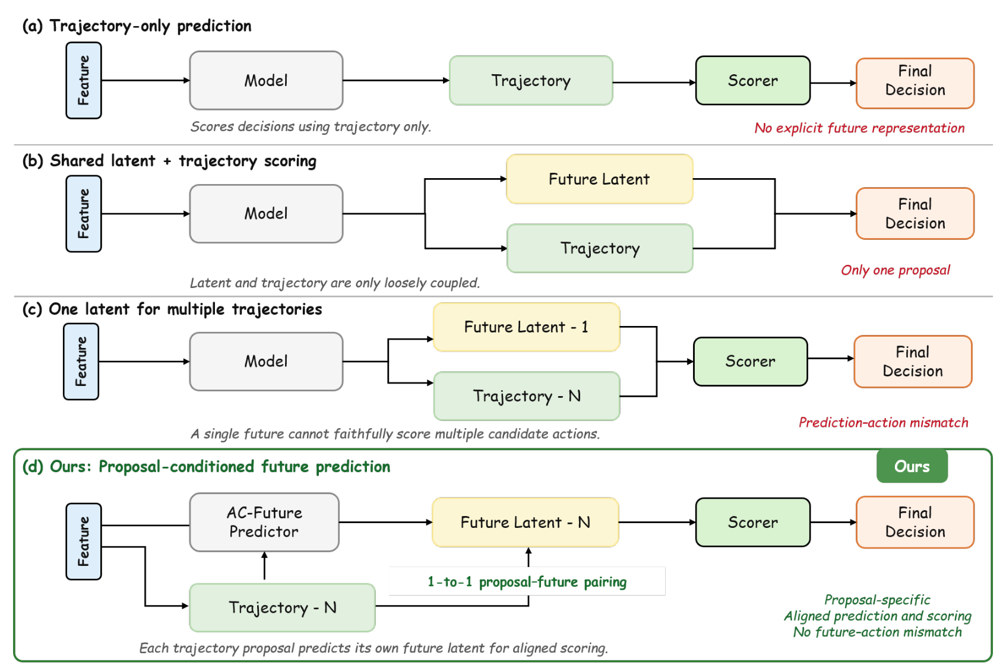
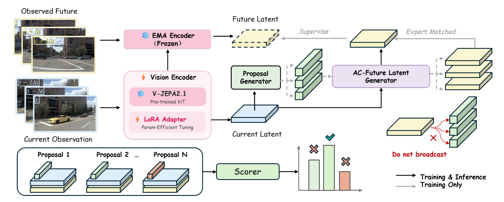
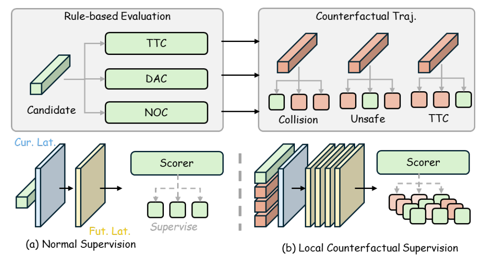
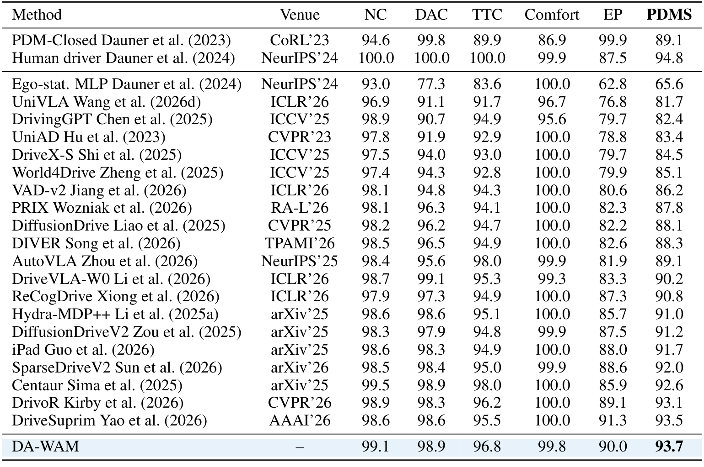
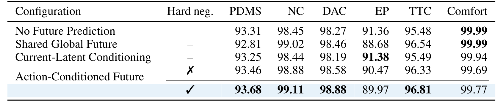
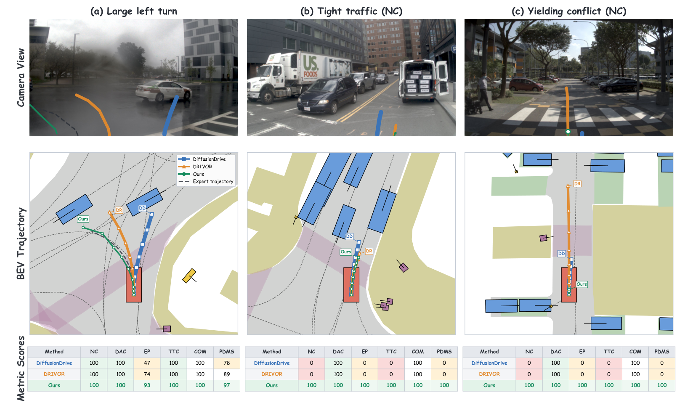

---
tags:
  - papers/autonomous-driving
aliases:
  - DA-WAM
  - 决策对齐未来潜变量
date: 2026-08-20
doi: 10.48550/arXiv.2608.19085
arxiv_id: 2608.19085
---

# DA-WAM: Decision-Aligned Future Latents for Driving World Models

## 核心信息

- 标题：DA-WAM: Decision-Aligned Future Latents for Driving World Models
- 标题翻译：DA-WAM：面向驾驶世界模型的决策对齐未来潜变量
- 作者：Ruiguo Zhong、Benshan Ma、Xiaolong Chen、Lang Zhang、Mingyue Feng、Yaonong Wang、Pei Liu、Jun Ma
- 机构：香港科技大学（广州）、零跑汽车、香港科技大学
- 发表时间：2026-08-20（arXiv v2）
- 发表渠道：arXiv 预印本
- DOI：[10.48550/arXiv.2608.19085](https://doi.org/10.48550/arXiv.2608.19085)
- arXiv：[2608.19085v2](https://arxiv.org/abs/2608.19085v2)
- 论文链接：[v2 原文](https://arxiv.org/pdf/2608.19085v2)
- 代码 / 项目：[论文所列代码地址](https://github.com/LeapWM/da-wam)
- 论文类型：自动驾驶规划方法

## 原文摘要翻译

预判自车采取动作后场景如何演化，是安全自动驾驶的基础；然而，世界模型在决策方面的潜力尚未充分释放。关键挑战在于让未来建模不仅具有预测能力，还能为决策提供信息：预测的未来必须直接影响轨迹选择。现有方法将未来表征学习与规划优化分离，或让多个候选轨迹共享预测状态，从而削弱了本应指导选择的动作特定后果。为弥合这一差距，作者提出 DA-WAM，在统一的决策目标下结合预测表征学习、动作条件未来建模和轨迹评分。DA-WAM 通过在线编码器和稳定的动量目标，在规划器优化过程中持续保留预测监督，使未来表征能够随驾驶任务共同演化。动作条件预测器为每条候选轨迹生成不同的未来潜在状态，再由以该未来潜变量为条件的因子化评分器评估。对于与专家匹配的轨迹，使用观测到的未来表征监督预测潜变量；安全关键困难负样本则在规划边界附近提供额外监督。作者在 NAVSIM-v1 和 NAVSIM-v2 上报告了领先性能，并用消融与诊断分析验证关键组件。

## 创新点

1. **逐候选的未来—动作配对**：为每条轨迹预测对应的未来潜变量，并把该变量直接交给评分器，使候选选择能够利用动作相关的未来特征。
2. **预测与规划联合适配**：以低秩适配更新在线视觉编码器，以指数移动平均维护目标编码器，在规划训练期间持续进行未来特征预测，避免预测表征完全固定。
3. **区分两类监督**：只用专家匹配候选接收真实未来的特征监督，同时用安全关键困难负样本提供规划因子、效用和排序标签，以增强相似轨迹之间的判别。

## 一句话总结

DA-WAM 将每条候选轨迹与其预测未来一一配对，再以规划标签训练评分器选择轨迹；其证据主要来自 NAVSIM 基准及匹配消融。

## 研究问题

在同一当前场景中，两条几何形状相近的轨迹可能对应不同的碰撞、车道偏离或让行后果。如果评分器只看到当前场景与轨迹形状，或让多条轨迹共享一个未来表征，就不一定能利用候选动作对应的差异。论文研究的是：**能否让每个候选各自预测未来，并使这个未来真正进入候选排序？**

*论文原图编号：Figure 1。四种预测与评分连接方式；最后一行是逐候选配对。*

这里的“决策对齐”有两层：表征学习在规划优化中持续更新；推理时每条候选只与其自身预测的未来一起评分。图中对其他方法的概括是作者提出的分类，不能据此断言所有既有世界模型都共享未来。〔原文第 1–4 页〕

## 数据与任务定义

### 输入、输出与指标

| 项目        | v2 论文设置                                               |
| --------- | ----------------------------------------------------- |
| 输入        | 前视摄像头的两帧历史图像，以及候选生成模块产生的自车轨迹                          |
| 候选        | 默认 32 条，每条由 8 个未来自车位姿表示；未来潜变量预测时距为 0.5 秒              |
| 输出        | 对各候选预测规划因子与总体效用，选择效用最高的轨迹                             |
| NAVSIM-v1 | navtest 含 12,146 个场景，主要报告 PDMS 及其分项                   |
| NAVSIM-v2 | navtest 使用更广的合规指标，主要报告 EPDMS；不能把它与 v1 的 PDMS 直接当作同一指标 |

规划因子包括无责任碰撞（NC）、可行驶区域合规（DAC）、自车行进进度（EP）、碰撞时间（TTC）和舒适性；数值均按 100 倍缩放，越高越好。论文另提到行驶方向合规作为诊断指标。v2 还报告交通灯、车道保持和其他扩展指标。〔第 8–10 页〕

### 训练与比较协议

主要 NAVSIM-v1 变体训练 20 个周期，使用 8 块 GPU、每卡批量 8，并按验证集表现选择检查点。受控消融固定训练数据、初始化、候选生成器、优化日程、检查点选择规则和评测协议。论文正文没有给出足以完整重建训练的全部超参数，应以所用版本的代码和配置为准。〔第 9–10 页〕

## 方法主线

### 机制流程

1. **输入与编码**：输入当前视觉观测，在线编码器输出当前场景令牌；候选生成器输出多条自车轨迹，供后续预测和评分使用。
2. **动作条件预测**：将每条候选编码为动作查询，以场景令牌为键和值进行交叉注意力，输出该候选独有的未来潜变量。
3. **逐候选评分**：评分器联合读取当前场景、候选动作及其未来潜变量，输出规划因子和总体效用，选择最高效用轨迹。
4. **训练时监督**：目标编码器提取真实未来特征，监督最接近专家的候选；生成候选与困难负样本均接收规划标签，目标编码器和难例检索在推理时移除。

*论文原图编号：Figure 2。在线场景编码、逐候选未来预测和评分；灰色路径仅用于训练。*

### 场景、动作和未来如何进入评分器

设当前观测为 $X_t$，候选集合为 $\mathcal{T}=\{\tau_i\}_{i=1}^{N}$。在线编码器输出 $M$ 个、每个维度为 $D$ 的场景令牌 $Z_t$；共享预测器与评分器依次计算：

$$
\begin{aligned}
Z_t &= E_\theta(X_t),\qquad a_i=E_\tau(\tau_i),\\
\hat Z_i &= P_\phi(Q=a_i,\ K=Z_t,\ V=Z_t),\\
h_i &= S^{\mathrm{enc}}_\psi(Z_t,\hat Z_i,a_i),\quad
\hat q_i=S^{\mathrm{factor}}_\psi(h_i),\quad
\hat s_i=S^{\mathrm{score}}_\psi(h_i,\hat q_i).
\end{aligned}
$$

预测器和评分器的参数跨候选共享，差异来自各自的动作查询及相关特征；总体效用头同时读取融合特征和预测因子。预测的是紧凑潜变量，论文没有声称可以直接解码出真实视频或精确物体轨迹。〔第 5–6 页〕

### 专家匹配、动量目标与梯度

离线日志只记录专家实际执行轨迹及其对应未来。作者按平均位移误差（ADE）寻找最接近专家的生成候选，只让该候选的预测令牌与真实未来令牌做逐令牌回归：

$$
\begin{aligned}
i_{\rm exp}&=\arg\min_i\operatorname{ADE}(\tau_i,\tau^{\rm exp}),\\
Z_{t+\Delta}&=\operatorname{sg}\!\left(E_{\bar\theta}(X_{t+\Delta})\right),\quad
\bar\theta\leftarrow\mu\bar\theta+(1-\mu)\theta,\\
\mathcal L_{\rm pred}&=\frac1M\sum_{m=1}^M
\ell\!\left(\hat Z_{i_{\rm exp},m},Z_{t+\Delta,m}\right).
\end{aligned}
$$

$\operatorname{sg}$ 表示停止反向传播；目标编码器不通过梯度更新，但其参数仍通过指数移动平均（EMA）跟随在线参数。在线视觉骨干由预训练 V-JEPA 2.1 初始化，基础权重冻结，选定层的低秩适配（LoRA）参数同时接收预测与规划梯度。最近候选通常不与真实执行轨迹完全相同，因此匹配仍是近似。〔第 5–6 页〕

### 困难负样本与联合目标

对每个场景，从离线轨迹库检索**几何上接近专家、但安全指标明显更差**的困难负样本，例如可能碰撞或偏离车道的轨迹。它们被追加到候选集，经过同一未来预测器和评分器；由于没有对应观测未来，不参加专家匹配，也不接收未来特征回归。其监督来自规则或仿真得到的规划因子、总体效用与候选对排序标签。〔第 7 页〕

*论文原图编号：Figure 3。困难负样本提供靠近安全边界的规划监督。*

总损失结合专家匹配的预测损失、各候选的因子损失、效用回归损失和成对排序损失；推理时直接取最高分：

$$
\mathcal L=\lambda_{\rm pred}\mathcal L_{\rm pred}+
\lambda_{\rm factor}\mathcal L_{\rm factor}+
\lambda_{\rm score}\mathcal L_{\rm score}+
\lambda_{\rm rank}\mathcal L_{\rm rank},
\qquad \tau^*=\arg\max_{\tau_i\in\mathcal T}\hat s_i.
$$

连续因子使用均方误差，二值因子使用二元交叉熵；排序标签由规则或仿真得到的候选效用决定，通过预测分数之差训练。论文称与困难负样本有关的排序对可过采样或提高权重，但正文未明确给出具体策略和参数。〔第 7–8 页〕

## 关键结果

### 两个基准上的位置

| 基准与方法                      | 视觉骨干 / 说明 |         论文报告分数 |
| -------------------------- | --------- | -------------: |
| NAVSIM-v1：World4Drive      | 相机方法      |      85.1 PDMS |
| NAVSIM-v1：DrivoR           | 相机方法      |      93.1 PDMS |
| NAVSIM-v1：DriveSuprim      | 相机方法      |      93.5 PDMS |
| NAVSIM-v1：DA-WAM           | 相机方法      |  **93.7 PDMS** |
| NAVSIM-v2：DiffusionDriveV2 | ResNet-34 |     87.5 EPDMS |
| NAVSIM-v2：DriveSuprim      | ViT/L     |     86.0 EPDMS |
| NAVSIM-v2：DA-WAM           | ViT/L     | **87.7 EPDMS** |

第一版基准上，DA-WAM 的无责任碰撞、道路合规、碰撞时间、舒适性与进度分别为 99.1、98.9、96.8、99.8、90.0。它比表中 DriveSuprim 高 0.2 分，但进度低于后者的 91.3。

第二版基准上，它比所列表现最强的 DiffusionDriveV2 高 0.2 分，但二者视觉骨干不同；这属于公开基准比较，并非仅改变一个变量的因果对照。〔第 9–10 页〕

*论文原图编号：Table 1。NAVSIM-v1 原始对比表。*

### 未来配对与困难负样本的匹配消融

| 未来配置 | 困难负样本 | PDMS | NC | DAC | EP | TTC |
| --- | --- | ---: | ---: | ---: | ---: | ---: |
| 不预测未来 | — | 93.31 | 98.45 | 98.27 | 91.36 | 95.48 |
| 共享全局未来 | — | 92.81 | 99.02 | 98.46 | 88.68 | 96.54 |
| 当前潜变量条件 | — | 93.25 | 98.44 | 98.19 | 91.38 | 95.49 |
| 动作条件未来 | 无 | 93.46 | 98.88 | 98.58 | 90.47 | 96.33 |
| 动作条件未来 | 有 | **93.68** | **99.11** | **98.88** | 89.97 | **96.81** |

*论文原图编号：Table 3。未来配置及困难负样本的匹配消融，原表还列出了舒适性。*

不加困难负样本时，动作条件未来比不预测未来高 **0.15** 分，比共享未来高 **0.65** 分。加入困难负样本再增加 **0.22** 分，无责任碰撞、道路合规和碰撞时间指标上升，但进度从 90.47 降至 89.97。

共享未来的无责任碰撞和碰撞时间指标较高，却因进度从 91.36 降到 88.68 而得到更低总分；这说明安全与进度的权衡必须结合分项看。作者将共享未来退化归因于动作与未来不匹配，这是与消融一致的机制解释，并非对潜变量内部信息的直接验证。〔第 10 页〕

### 预测表征与候选数量

| 在线编码器与预测目标 | 目标编码器 | PDMS |
| --- | --- | ---: |
| 冻结，V-JEPA 2.0 目标 | 冻结 | 91.26 |
| 冻结，V-JEPA 2.1 稠密目标 | 冻结 | 91.95 |
| LoRA，V-JEPA 2.0 目标 | 冻结 | 92.74 |
| LoRA，V-JEPA 2.1 稠密目标 | 冻结 | 92.98 |
| 全量微调，V-JEPA 2.1 稠密目标 | 冻结 | 92.62 |
| LoRA 与稠密目标 | 独立 / 共享 / EMA | 93.10 / 93.34 / **93.68** |

稠密目标分别使冻结编码器和 LoRA 编码器提高 0.69、0.24 PDMS；稠密目标下 LoRA 比全量微调高 0.36。固定 LoRA 与稠密目标时，EMA 目标比冻结目标高 0.70。候选数为 1、8、16、32、64 时，PDMS 分别为 **87.11、90.76、91.89、93.68、93.68**：在该设置下收益到 32 条趋于饱和，但论文没有据此给出通用最优候选数。〔第 11–12 页〕

### 定性案例

*论文原图编号：Figure 4。大左转、密集交通和让行冲突三种场景的选轨比较。*

在展示的密集交通与让行场景中，两个比较方法发生 NC 与 TTC 失分，而 DA-WAM 选择了避开冲突的候选；这些示例有助于理解行为，但不能代表所有场景的失败率。〔第 11–12 页〕

## 深度分析

### 未来是否真的影响选择

该方法的接口允许未来特征影响评分：$\hat Z_i$ 与 $Z_t$、$a_i$ 一起进入共享评分器，并通过规划损失接收梯度。匹配消融显示，该设计优于论文中的无未来、当前潜变量和共享未来对照；但增益较小，且评分器仍可同时利用轨迹几何及当前场景。仅凭这些结果，无法量化评分器究竟使用了多少未来信息，也不能证明每个候选的预测具有正确的物理或交互语义。

更强的诊断应固定候选和场景，分别打乱候选与未来的配对、替换为零或共享未来，测量选中轨迹变化、成对排序准确率及安全指标，并与计算量相近的额外特征通道对照。

### 预测监督与规划监督的区别

专家匹配使观测未来有明确锚点，避免把同一个专家未来直接赋给所有未执行轨迹。困难负样本则通过规则或仿真生成的规划标签约束排序；它们**没有**真实未来图像或潜变量标签。因此，这一方案能学习对规则结果有用的候选特征，但不能把所有候选潜变量视作经过直接验证的反事实世界状态。

最近候选与实际轨迹之间的偏差仍可能造成监督错位：即使 ADE 最小，靠近边界时微小几何差异也可能改变交互结果。可按匹配误差、碰撞边界距离分桶，分别检查特征误差和选轨收益。

### 计算与复现

共享场景编码降低重复计算，但未来预测和评分仍随候选数量增长；论文给出候选数量消融，没有在所读 v2 文本中报告可核对的端到端时延或显存曲线。复现应固定候选集合与检查点，核对每卡批量、输入帧、0.5 秒目标、8 位姿、评分标签和困难负例生成方式，再分别记录训练与推理成本。

## 局限

1. **反事实监督不完整**：未执行轨迹没有观测未来，潜变量的动作后果只能由有限的专家匹配和规划标签间接约束。
2. **基准外推受限**：所读 v2 只报告 NAVSIM-v1/v2。NAVSIM-v1 的日志驱动评测使用非反应式仿真；这些基准结果不能充分覆盖其他交通参与者对自车动作的真实反应，也不能证明真实道路安全。
3. **规划标签依赖评测规则**：困难负样本是否有效受轨迹库覆盖、几何和安全阈值以及规则指标影响；v2 正文未完整列出这些参数。
4. **细节与不确定性不足**：正文未报告完整的损失权重、EMA 系数、优化器超参数、逐组件成本和重复试验误差；小幅分差应结合这些缺失谨慎理解。
5. **版本边界**：本笔记以本地论文库保存的第二版对照附件为准。更新的第三版已改动摘要、作者顺序与实验范围；不能将第三版的 Bench2Drive 数字混入这里的结果。

## 我的笔记

### 可复用的实验设计

- **固定候选池**：将生成质量与评分质量分开。对同一批候选比较无未来、共享未来、逐候选未来和随机错配未来，同时报告总分与各安全、效率分项。
- **拆开监督来源**：维护“真实执行未来”和“规则计算的候选结果”两条标注链；非专家候选没有真实未来时，不复制专家特征作为标签。
- **检验边界样本**：按专家轨迹距离与安全指标差异采样近邻，再与随机负例及模型当前最易混淆的负例比较，记录安全收益是否伴随过度保守。
- **检查部署代价**：统计 1、8、16、32、64 个候选下的编码、未来预测、评分耗时和显存，判断得分增益是否覆盖额外代价。

### 后续问题

1. 打乱未来与动作的配对后，候选排序变化是否集中在安全关键场景？
2. 当专家和最近候选的 ADE 较大时，减少或加权未来回归是否能改善表现？
3. 在反应式多车仿真中，困难负例带来的安全收益和进度代价是否仍存在？

## 引用

- Zhong, R., Ma, B., Chen, X., et al. *DA-WAM: Decision-Aligned Future Latents for Driving World Models*. arXiv:2608.19085v2, 2026. [论文](https://arxiv.org/abs/2608.19085v2)。
- Dauner, D., et al. *NAVSIM: Data-Driven Non-Reactive Autonomous Vehicle Simulation and Benchmarking*. NeurIPS 2024. [arXiv](https://arxiv.org/abs/2406.15349)。
