---
tags:
  - papers/自动驾驶
aliases:
  - Expand-and-Prune
date: 2026-10-16
arxiv_id: "2610.23262"
---

# Expand-and-Prune: Test-Time Candidate-Space Adaptation for End-to-End Autonomous Driving

## 核心信息

- 标题: Expand-and-Prune: Test-Time Candidate-Space Adaptation for End-to-End Autonomous Driving
- 标题翻译: 面向端到端自动驾驶的测试时轨迹候选空间自适应
- 作者: Fabian Schmidt, Karol Fedurko, Markus Enzweiler, Abhinav Valada
- 机构: Esslingen University of Applied Sciences；University of Freiburg
- 发表时间: 2026-10-16
- 发表渠道: arXiv 预印本
- arXiv: 2610.23262
- 论文链接: https://arxiv.org/abs/2610.23262
- 代码 / 项目: https://github.com/iis-esslingen/Expand-and-Prune
- 论文类型: 自动驾驶规划方法

## 原文摘要翻译

基于候选轨迹的端到端驾驶规划器在有限的轨迹假设集合上进行推理。然而，对于稀疏规划器，有限候选可能无法充分覆盖与当前场景相关的驾驶动作；固定的下游候选预算也没有考虑预测的不确定性。为解决这些问题，作者提出 `Expand-and-Prune`，在不更新已学习参数的条件下，同时调整测试时的候选覆盖范围和处理容量。该框架利用**语义驾驶意图**和**从上一时刻传播的预测**扩充原生候选集合，再根据中间轨迹得分的不确定性自适应裁剪候选。在四种不同的候选规划器和四个基准上的实验中，该方法均改善了规划表现。在 `LangAuto` 上，驾驶得分从 `68.2` 提高到 `75.9`；在 `Bench2Drive`、`Fail2Drive` 和 `NAVSIMv2` 上也获得提升，其中分布外场景的提升尤为明显。此外，在完整设置下，**最终选中轨迹的 `72.5%` 来自新增的意图引导或时序候选**，说明候选扩充提供了规划器原生集合之外有用的假设。代码已公开。

## 创新点

1. **调整候选覆盖**：将冻结规划器原生候选与意图相关原型、上一帧预测合并，在推理时改变候选密度，不重新训练评分器。
2. **调整候选容量**：根据中间得分分布的归一化熵决定保留数量，在不确定帧保留更多备选，在得分集中的帧减少后续计算。
3. **接口级适配**：在扩散去噪或粗到精筛选的现有边界接入，按规划器接口选择可用组件；通过来源分析和平均容量匹配对照检验设计作用。

## 一句话总结

这篇论文把冻结规划器的轨迹集合当作可在推理阶段调整的接口，用意图和时序增加候选，再按得分熵分配后续处理预算。

## 研究问题

候选式规划器的质量受两层限制：候选集合可能缺少当前动作需要的几何形态；固定 `Top-K` 将同样的后续计算分配给清晰和模糊场景。作者关心的是在不修改规划器参数和原评分函数的前提下，能否同时改变候选覆盖和计算容量。

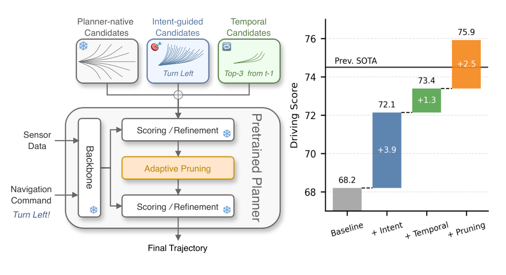
*论文原图编号：Fig. 1。框架以新增意图与时序候选扩充集合，并在后续阶段自适应裁剪。*

## 数据与任务定义

- `LangAuto` 使用 `CARLA` 的八个城镇，按短于 `150 m`、`150–500 m`、长于 `500 m` 划分路线。驾驶得分由路线完成度和违规得分相乘，不能单独代表真实事故率。
- `Bench2Drive` 包含 `44` 类交互场景、`220` 条短路线；`Fail2Drive` 包含 `100` 对基础和分布偏移路线，报告 `DS`、成功率及其调和平均数。
- `NAVSIMv2` 在真实驾驶日志上评价候选轨迹，报告综合 `EPDMS` 及碰撞、可行驶区域、交通规则、进度和舒适性子项；它不是实车闭环实验。

## 方法主线

### 机制流程

1. **构建意图候选**：离线按轨迹几何启发式分配六种动作类别，在每类内部聚类得到轨迹原型库。推理时按模型给出的动作概率分配新增候选数，并从相应库采样。
2. **加入时序候选**：根据上一帧最终分数提取若干高分轨迹，用相邻自车位姿将各轨迹点从旧坐标系变换到当前坐标系；论文未进行时间重采样。
3. **初步处理与裁剪**：将原生、意图和时序候选并入原规划器；在首次产生有意义中间分数的位置，根据得分熵决定要送入下一阶段的候选数。
4. **继续原规划器**：只对保留候选执行剩余去噪或精排，使用原评分函数输出最终轨迹。参数保持冻结，所用模块随规划器接口而变。

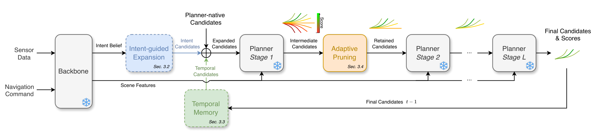
*论文原图编号：Fig. 2。图示候选扩充、时序记忆、冻结规划器和中间阶段裁剪的连接方式。*

### 预算与坐标变换

对分数 $s_i$ 以温度 $\tau$ 得到概率 $p_i=\operatorname{softmax}(s_i/\tau)$，并计算归一化熵与预算：

$$
h=-\frac{\sum_i p_i\log p_i}{\log N},\qquad K=\operatorname{round}\!\left(K_{\min}+h(K_{\max}-K_{\min})\right).
$$

上一帧最终分数用于记忆容量，中间分数用于裁剪容量；两处的候选数和上下界不同。熵高只表示**当前评分分布更平坦**，其是否等同风险上升需要额外验证。相邻帧位姿为 $T_t^w$ 时，旧轨迹点以 $(T_t^w)^{-1}T_{t-1}^w$ 转到当前自车坐标系。

### 规划器适配细节

| 规划器 | 实际接入 | 关键设置 |
|---|---|---|
| LAD-Drive | 意图、时序、裁剪 | 原生 `20` 条，加 `30` 条意图候选；记忆 `1–5` 条，第一步去噪后保留 `4–12` 条 |
| BridgeDrive | 时序、裁剪 | 从上一帧保留 `1–3` 条；首次更新后保留 `3–10` 条，再执行余下扩散步骤 |
| DriveSuprim | 仅裁剪 | 粗排后将原先固定 `256` 条改为 `16–64` 条 |
| SparseDriveV2 | 仅裁剪 | 路径和速度分支分别依据各自得分选择容量，再进行组合和精排 |

论文在两处熵预算中使用 $\tau=0.5$ 的主设置。不同规划器并没有运行完全相同的模块组合。

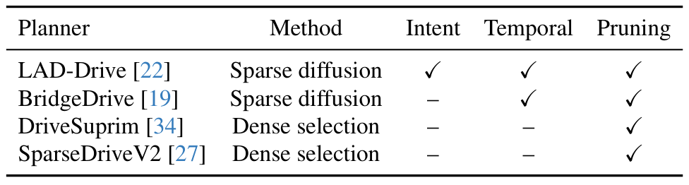
*论文原图编号：Table 1。四个规划器的组件适配范围不同。*

## 关键结果

### 主结果和分步消融

| LangAuto 设置 | 平均驾驶得分 ↑ | 路线完成度 ↑ | 违规得分 ↑ |
|---|---:|---:|---:|
| LAD-Drive 原模型 | 68.2 | 74.5 | 0.90 |
| 加意图候选 | 72.1 | 79.5 | 0.89 |
| 再加自适应时序记忆 | 73.4 | 80.9 | 0.90 |
| 再加自适应裁剪 | 75.9 | 81.1 | 0.93 |
| 最终设置的平均容量匹配固定预算 | 74.0 | 80.2 | 0.90 |

消融是顺序选择配置后传给下一阶段，并非完整的所有组合实验。意图扩充单独带来更高的路线完成度，但 `IS` 从 `0.90` 降到 `0.89`；完整方法中 `IS` 才升到 `0.93`。仅以 `30` 或 `50` 条意图候选替换原生锚点时，`DS` 分别降到 `62.8` 和 `64.4`，提示两类候选互补。

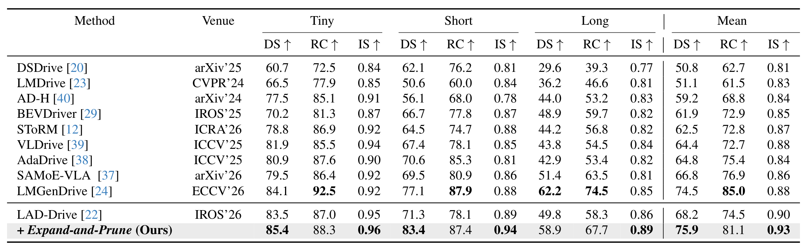
*论文原图编号：Table 2。LangAuto 不同路线长度的闭环结果。*

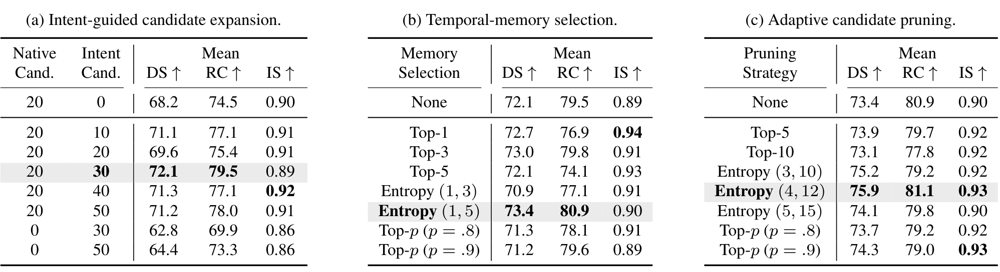
*论文原图编号：Table 3。按意图扩充、时序记忆和裁剪顺序展示消融。*

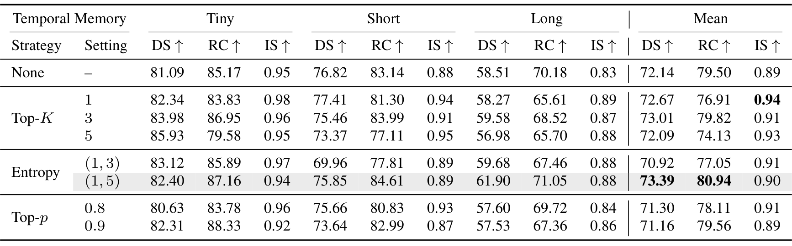
*论文原图编号：Table 7。时序记忆的固定数量、熵策略与累计概率策略比较。*

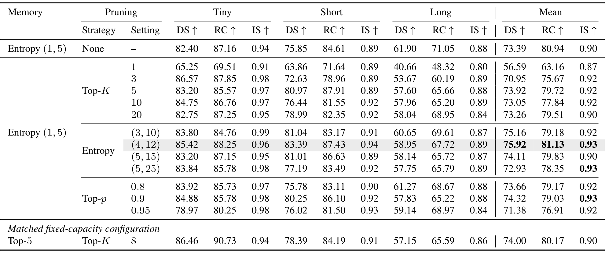
*论文原图编号：Table 8。裁剪容量与平均容量匹配的固定策略对照。*

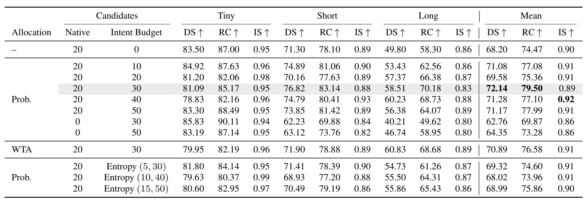
*论文原图编号：Table 6。意图扩充消融：Prob. 按概率分配，WTA 只使用概率最高的动作。*

### 跨规划器与运行代价

| 设置 | 原始结果 | 接入后 | 实际变化 |
|---|---:|---:|---|
| BridgeDrive，Bench2Drive，DS | 95.9 | 96.5 | 时序与裁剪 |
| BridgeDrive，Fail2Drive 泛化集，调和均值 | 76.4 | 80.5 | 时序与裁剪 |
| DriveSuprim，ResNet-34，EPDMS | 83.069 | 83.664 | 仅裁剪 |
| DriveSuprim，ViT-L，EPDMS | 87.033 | 87.264 | 仅裁剪 |
| SparseDriveV2，EPDMS | 87.040 | 87.368 | 仅裁剪 |

`NAVSIMv2` 的总分虽提高，三组模型的自车进度和车道保持均略降，不能表述为每项指标都改善。完整 `LAD-Drive` 方法在 `NVIDIA L40S` 上总延迟从 `45.0 ms` 增至 `47.2 ms`；其中裁剪相对扩充但未裁剪的设置降低了轨迹头延迟。数值依赖具体硬件、实现和模型。

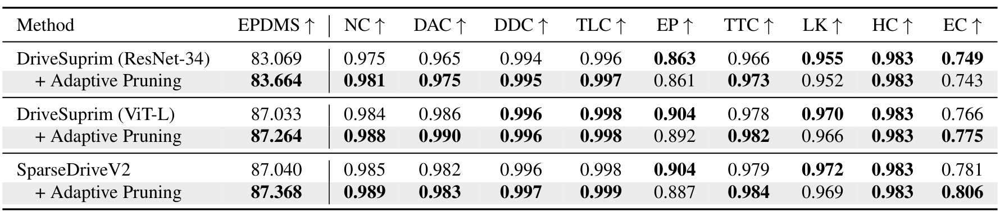
*论文原图编号：Table 9。NAVSIMv2 的综合得分和子指标同时显示收益与代价。*

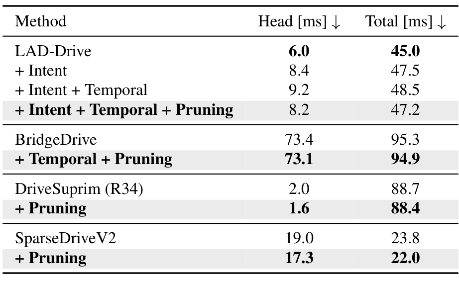
*论文原图编号：Table 5。各规划器轨迹头和总推理延迟。*

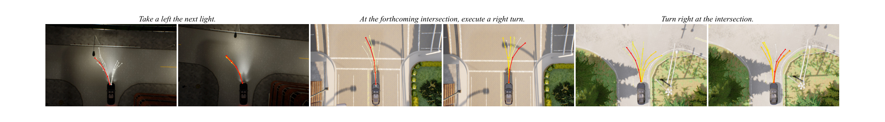
*论文原图编号：Fig. 4。作者选取的闭环定性案例用于说明候选覆盖变化。*

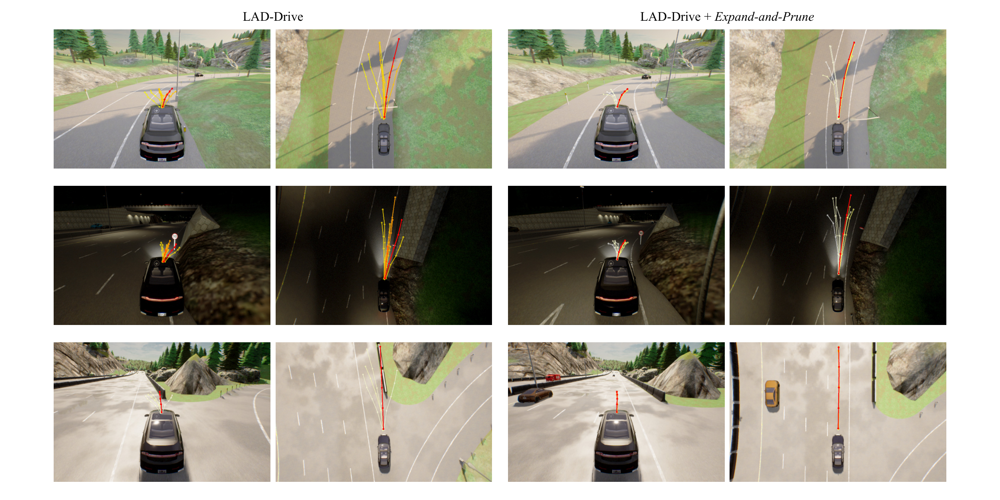
*论文原图编号：Fig. 6。附录中的长路线定性案例，不能代替整体失败率统计。*

## 深度分析

### 为什么可能有效

原生锚点提供较广覆盖，意图原型在当前语义概率较高的区域增加密度；时序候选提供与上一帧一致的几何选择。裁剪则减少扩充后进入昂贵阶段的候选，同时允许分数更分散的场景保留更多备选。论文报告最终选中轨迹中原生、意图和时序来源分别为 `27.5%`、`31.3%` 和 `41.2%`。这说明新增来源经常参与决策，但来源比例本身不能独立证明每个模块的因果收益。

平均记忆容量为 `4.6`、裁剪后平均 `8.1` 条；固定 `Top-5` 记忆和 `Top-8` 裁剪得到 `74.0 DS`，低于自适应的 `75.9`。这个对照支持当前基准下逐帧调整有价值，但它并未穷举所有固定预算，也未证明熵已校准为安全风险。

### 复现与迁移

复现时应先保留原规划器检查点和评分函数，记录动作概率、候选来源、轨迹坐标系、时间间隔及每阶段数量。先复现单模块和固定预算，再比较综合分数、各安全子项与总时延。其他规划器若不暴露语义概率、可注入轨迹或中间评分，不能直接复制完整流程。

## 局限

- 意图引导只在提供动作概率的 `LAD-Drive` 上评估；其他规划器的提升主要来自不同组件组合。
- 时序记忆仅取上一帧且未重采样；异步规划频率、误差累积和动态交通响应需要进一步实验。
- 得分熵取决于温度和分数标度，不是对碰撞概率的直接估计；场景外分数失准时可能错误裁剪。
- 主要证据来自模拟闭环和日志轨迹评价；论文未证明在真实车辆和所有长尾场景中的安全性。

## 我的笔记

可把候选来源、评分熵、被剪掉的轨迹质量和最终安全子项一起记录，检查高熵是否真的对应需要更多候选的帧。进一步可比较校准后的风险信号、候选间几何多样性，以及等计算量固定预算，避免把模型分数不确定性直接当作环境风险。

## 引用

- Schmidt et al. (2026). LAD-Drive: Bridging Language and Trajectory with Action-Aware Diffusion Transformers.
- Liu et al. (2026). BridgeDrive: Diffusion Bridge Policy for Closed-Loop Trajectory Planning in Autonomous Driving.
- Yao et al. (2026). DriveSuprim: Towards Precise Trajectory Selection for End-to-End Planning.
- Sun et al. (2026). SparseDriveV2: Scoring Is All You Need for End-to-End Autonomous Driving.
- Gerstenecker et al. (2026). Fail2Drive: Benchmarking Closed-Loop Driving Generalization.
