---
tags:
  - papers/自动驾驶
  - trajectory-planning
  - world-model
aliases:
  - ManeuverFlow
date: 2026-10-09
arxiv_id: "2610.13409"
---

# ManeuverFlow: Maneuver Hypothesis Generation with Future Evidence for Trajectory Evaluation and Refinement in End-to-End Autonomous Driving

## 核心信息

- 标题: ManeuverFlow: Maneuver Hypothesis Generation with Future Evidence for Trajectory Evaluation and Refinement in End-to-End Autonomous Driving
- 标题翻译: ManeuverFlow：利用未来证据生成驾驶动作假设、评估并细化端到端自动驾驶轨迹
- 作者: Yuhao Wei, Yong Chen, Chen Yang, Yingchen Wang, Delin Ouyang, Lingfeng Qi, Qi Lan, Zhanhua Zhang, Jie Li, Guofa Li
- 机构: Chongqing University；Artificial Intelligence Center, Geely Automotive Research Institute
- 发表时间: 2026-10-09
- 发表渠道: arXiv 预印本
- arXiv: 2610.13409
- 论文链接: https://arxiv.org/abs/2610.13409
- 代码 / 项目: https://github.com/wyh-autonomy/maneuverflow
- 论文类型: 自动驾驶轨迹生成、评估与细化方法

## 原文摘要翻译

复杂场景中的端到端规划需要建模多种驾驶意图，并根据场景上下文和未来风险选择最合适的轨迹。然而，**多查询回归可能坍缩为单一模式**；**基于锚点和生成式的规划器**则面临共同的规模瓶颈：**较小的候选集限制了动作覆盖或高质量轨迹的发现**，较大的候选集又增加生成和评分成本。作者提出 ManeuverFlow，一步生成对应不同意图的轨迹，并利用当前和未来证据对其评估与细化。

模型选择相关动作模式，从高斯混合先验中采样相应噪声，经由按动作路由的专家混合 MeanFlow 场映射为特定意图的轨迹。沿每条候选路径聚合当前特征及世界模型预测的未来特征，形成用于预测 PDM 因子的轨迹专属证据；细化器使用同一证据预测所选候选的局部 Frenet 残差，再将细化与保留的候选联合重新评分并选出结果。

使用轻量级 TransFuser 风格的 ResNet-34 骨干时，该方法在 NAVSIM 两版测试集分别达到 90.6 规划分和 90.1 扩展规划分。

在 WorldEngine 的三维高斯泼溅闭环基准上，日志回放和 IDM 控制交通设置下的 PDMS* 分别为 75.19 和 74.58，均为所列结果中的最高值。代码见项目链接。

## 创新点

1. **动作结构化的一步生成**：用专家轨迹的运动特征构建混合先验，按场景选择分量并路由到对应专家，使候选既有显式来源，又能在有限预算内覆盖不同运动趋势。
2. **共享未来场中的路径证据**：每个规划周期只预测一次未来 BEV，再按候选轨迹位置和时间读取证据；这让评分器和细化器复用未来预测，同时得到与路径相关的特征。
3. **细化后重新竞争**：对预评分选出的候选预测局部 Frenet 修正，以修正轨迹替换对应原轨迹，再与其他保留轨迹一起重取证、重评分，避免把第一次排序直接当作最终决策。

## 一句话总结

ManeuverFlow 将动作路由生成、共享未来特征查询和局部轨迹修正放入固定大小的候选池，通过重评分选出最终规划。

## 研究问题

多模态规划同时受候选覆盖和筛选能力约束：候选太少可能遗漏可行方案，太多会增加生成与评估开销；只看当前场景则难以直接利用未来风险。论文研究如何在固定候选预算下组织不同运动趋势，并让生成、验证和改进共享同一条计算链。其“意图”由轨迹运动量定义，而非独立的人类语义意图标注。

## 数据与任务定义

输入为当前左、前、右三相机图像、自车状态及导航命令；TF 版本额外输入激光雷达栅格，纯相机 LTF 版本以可学习潜模板替代。输出为自车坐标系下未来 4 秒的 8 个位置与航向点；从 64 条候选中选择一条。混合先验的运动分量及统计量只用 NAVSIM navtrain 专家轨迹拟合。

NAVSIM 测试集使用日志未来和非反应式模拟器，第一版主要报告规划分，第二版报告包含更广指标的扩展规划分。论文在第二版评测中直接复用第一版检查点和五因子选择器。

WorldEngine 从测试集日志重建 288 个高风险场景并渲染相机观测：日志回放设置重放背景交通，IDM 设置令周围车辆按规则响应；两者都让自车基于更新观测闭环重规划。

由于没有激光雷达，闭环实验只使用纯相机版本。PDMS* 是该闭环基准的综合分数，不应与 NAVSIM 的 PDMS 直接混为一谈。

## 方法主线

### 机制流程

1. **场景编码与路由**：输入传感器、自车状态和导航，编码为 BEV、交通参与者及场景特征；动作头预测八个运动分量的概率，推理时取概率最高的三个并归一化。
2. **一步产生候选**：按最大余数法把 64 个名额分配给三个分量，从对应高斯分布采样，经由按分量选择专家的 MeanFlow 一步生成 64 条基础轨迹。
3. **用共享未来评估**：世界模型从当前场景预测未来 1、2、3、4 秒的共享 BEV 特征；读取器沿每条候选的位置和时间查询当前与未来特征，评分器预测五个 PDM 因子并预排序。
4. **局部修正与复选**：细化器用相同轨迹证据修正预排序选出的 16 条候选，替换其原位置；保留另外 48 条，令最终 64 条重新查询共享场并联合评分，取最高分轨迹。

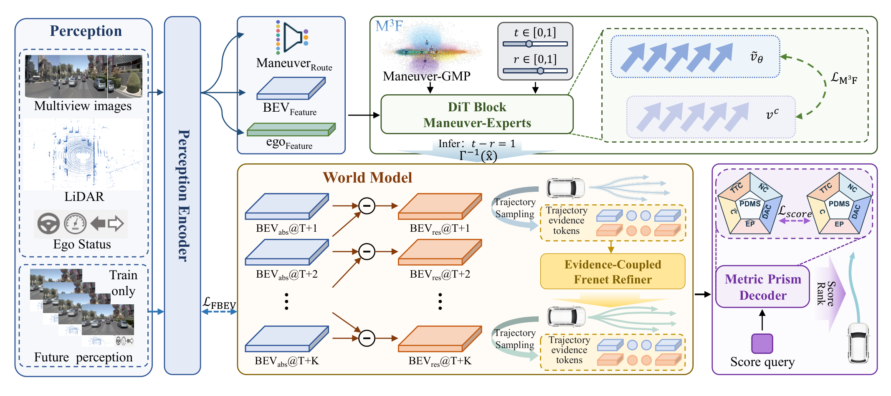
*论文原图编号：Figure 3。生成、共享未来取证、细化及联合重评分的整体流程。*

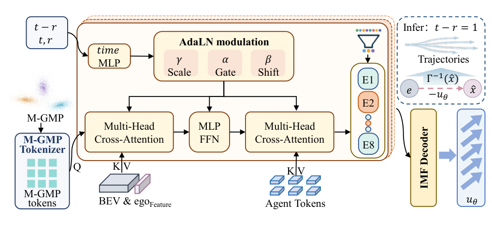
*论文原图编号：Figure 4。M3F 的上下文注意力、时间调制和动作路由专家。*

### 运动先验与一步流

每条专家轨迹先转为逐步位移，并将航向编码为正弦和余弦。八类运动先验由位移、平均航向与速度趋势的规则划分，再逐类拟合固定的因子化高斯。路由头用专家轨迹与分量的距离构建软目标，训练场景条件下的分量概率；其分量名称表述的是运动趋势，并不证明模型识别了语义车道变换或驾驶员意图。

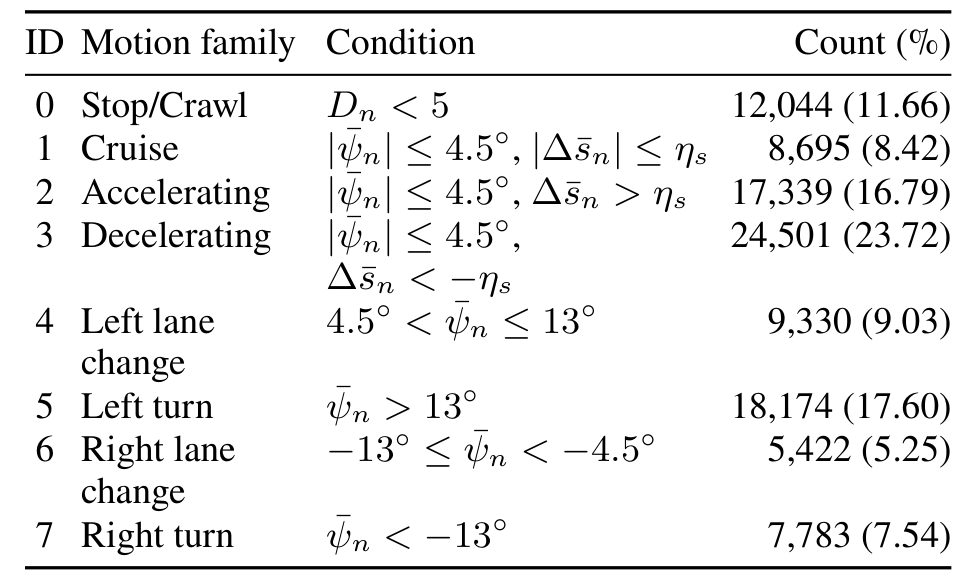
*论文原图编号：Table S1。动作先验的规则划分与阈值。*

设专家轨迹编码为 $x^{gt}$，采样的先验编码为 $e$，则训练用插值与条件速度为 $z_t=(1-t)x^{gt}+te$、$v_c=e-x^{gt}$。M3F 以场景、区间 $(r,t)$ 和分量索引为条件学习区间平均速度；采用 Improved Mean Flows 的边界速度和雅可比向量积构建训练目标。推理只调用一次完整区间的网络：

$$
\tau=\Gamma^{-1}\left(e-u_\theta(e,0,1\mid C,m)\right).
$$

这里 $\Gamma^{-1}$ 将归一化位移还原并累积为路径，同时解码航向。M3F 使用六个带动作专家的块；第二阶段构造候选时按预测概率对前三分量作随机分类采样，部署时改用最大余数分配。两者不可混同。

### 未来证据、评分与细化

未来模型每周期预测一组与候选无关的绝对及时间残差 BEV 特征。训练时，以未来观测经共享编码器得到的特征为停止梯度目标，并用有效空间重叠掩码监督；推理不读取真实未来帧。路径读取器按候选点的时间和坐标从共享场抽样，形成每条轨迹的证据记忆。评分器使用候选集合自注意力和对应证据的交叉注意力，预测无碰撞 NC、可行驶区域 DAC、自车进度 EP、碰撞时间 TTC 和舒适度 Comf 五个因子。

预测因子 $s^f$ 的部署排序分数采用固定对数形式：

$$
S=\log(s^{NC}+\epsilon)+\log(s^{DAC}+\epsilon)+\log(5s^{EP}+5s^{TTC}+2s^{Comf}+\epsilon),\quad \epsilon=10^{-6}.
$$

因此 v2 的额外指标会参与最终评测，却不参与这一选择器。细化训练在当前 64 条候选中，寻找与基础轨迹属于同一动作分量、模拟器分数最高的参考轨迹；以局部切向、法向和航向差构造 Frenet 目标，采用 Smooth-L1 学习残差。候选生成、模拟器标签和参考选择均截断梯度；同分量最优轨迹自身可成为参考，因此目标可能为零。

### 训练与复现配置

第一阶段训练感知、辅助头和 M3F；第二阶段联合训练所有推理模块，并用当前模型产生的 64 条候选获取模拟器标签和细化目标。辅助、生成、验证、细化的损失权重分别为 $1:4:2:2$。三次独立训练均使用 4 张 RTX 4090、全局批量 32、AdamW；两阶段基础学习率分别为 $4\times10^{-4}$ 和 $2\times10^{-4}$，第二阶段感知与 M3F 的学习率乘以 0.2。最终指标先对每个检查点评测五次，再对三个检查点求均值。

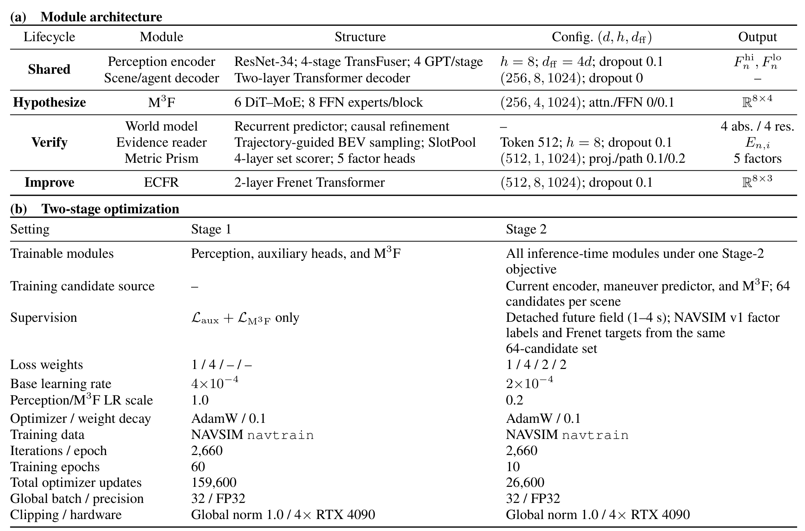
*论文原图编号：Table S2。模块接口、两阶段优化及硬件配置。*

## 关键结果

### 主结果和闭环表现

| 协议与比较 | 对照 | ManeuverFlow | 说明 |
|---|---:|---:|---|
| NAVSIM v1，DriveSuprim，PDMS | 89.9 | 90.58 | TF 版本；分数为论文所列均值 |
| NAVSIM v1，MeanFuser LTF，PDMS | 89.0 | 89.98 | 纯相机版本 |
| NAVSIM v2，MeanFuser LTF，EPDMS | 89.5 | 89.70 | 纯相机；TF 为 90.14 |
| WorldEngine Log，MeanFuser，PDMS* | 73.81 | 75.19 | 闭环、日志交通 |
| WorldEngine IDM，MeanFuser，PDMS* | 73.28 | 74.58 | 闭环、反应式交通 |

在 WorldEngine 中，纯相机版本在日志回放和 IDM 设置的自车进度分别为 60.68 和 60.89，成功率为 87.48 和 87.92。NAVSIM v1 的 TF 无碰撞因子为 98.42，低于表中部分基线；综合分领先不意味着各安全指标均领先。

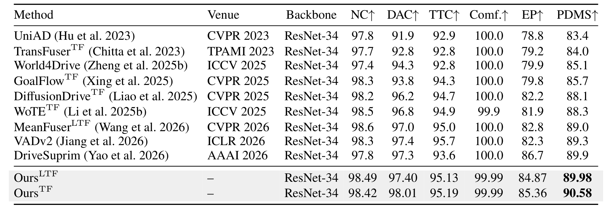
*论文原图编号：Table 1。NAVSIM v1 的综合分及子指标比较。*

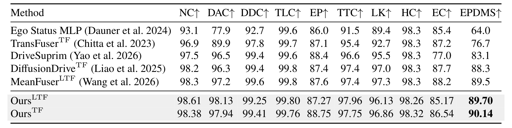
*论文原图编号：Table 2。NAVSIM v2 的扩展指标比较。*

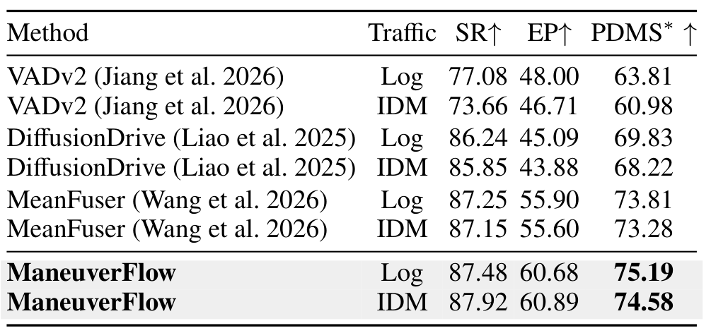
*论文原图编号：Table 3。WorldEngine 全场景闭环结果。*

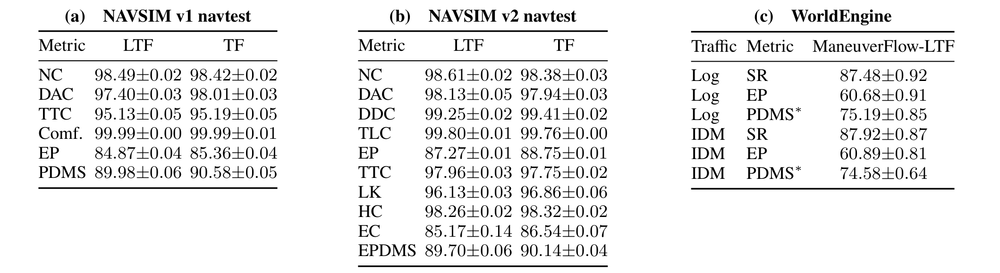
*论文原图编号：Table S3。三个独立训练检查点的均值和样本标准差。*

三个检查点在 NAVSIM v1 的 TF 综合分为 $90.58\pm0.05$，v2 扩展综合分为 $90.14\pm0.04$。纯相机版本在 WorldEngine 的日志回放和 IDM 设置下分别取得 $75.19\pm0.85$ 和 $74.58\pm0.64$ 的闭环综合分。这些是三次训练的样本标准差，不是正式置信区间；论文也未给主要消融提供配对随机种子的误差估计。

### 消融：生成、未来与细化

| TF 设置 | NC | EP | PDMS |
|---|---:|---:|---:|
| 候选式 MeanFlow，当前证据 | 97.21 | 81.05 | 86.14 |
| 动作先验 + 参数量匹配 Dense-XL | 97.02 | 81.63 | 87.91 |
| 动作先验 + M3F，仅当前证据 | 97.64 | 82.12 | 88.35 |
| 再加入未来证据，未细化 | 98.52 | 84.41 | 89.93 |
| 完整模型去除未来分支 | 98.27 | 84.50 | 90.03 |
| 完整模型采用 KMeans-8 先验 | 98.42 | 84.53 | 90.04 |
| 完整模型 | 98.42 | 85.36 | 90.58 |

固定先验时，M3F 比参数量匹配的 Dense-XL 高 0.44 分；完整模型比 KMeans-8 对照高 0.54 分。未细化时未来证据提升 1.58 分，而完整模型中去掉未来分支后降低 0.55 分；对已有未来证据的系统加入细化提升 0.65 分，但 NC 从 98.52 降至 98.42。未来与细化的收益并非简单相加，累计消融也不等于对每一模块做了完全独立的因果隔离。

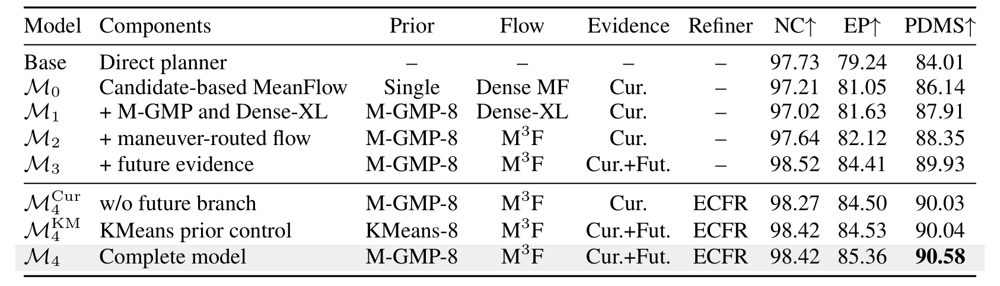
*论文原图编号：Table 4。累积消融及匹配参数量、先验和未来分支的对照。*

### 候选预算与选择误差

| 保留分量 $k$ 或候选数 $N$ | 测量结果 | 解读 |
|---|---:|---|
| $k=1,2,3,4$ | 目标分量召回 87.20%、96.46%、98.30%、99.21% | 目标由轨迹到分量距离确定 |
| $k=3,N=32$ | 90.41 PDMS；58.62 候选生成帧/秒 | 较小预算 |
| $k=3,N=64$ | 90.58 PDMS；53.86 候选生成帧/秒 | 默认设置 |
| $k=3,N=128$ | 90.56 PDMS；47.12 候选生成帧/秒 | 该设置下增加预算无明显收益 |

帧率只覆盖感知到 M3F 的候选生成路径，不是完整规划系统端到端帧率。分量召回是命中距离匹配的目标分量，不是人工语义意图分类准确率；预算扫描使用冻结检查点，是事后敏感性分析。

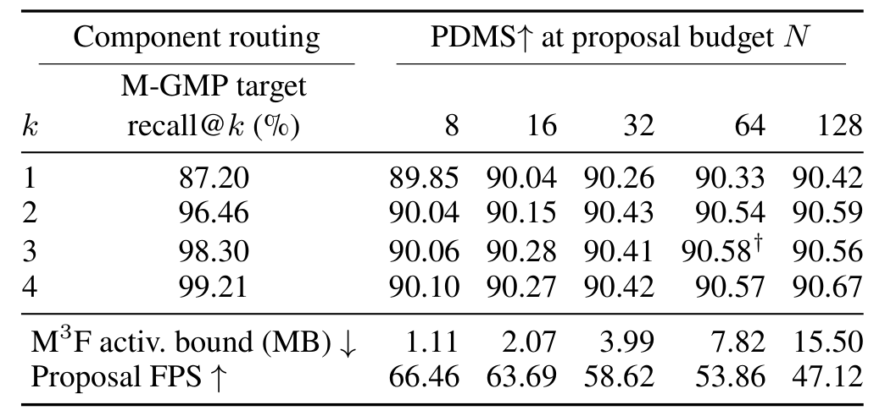
*论文原图编号：Table 5。路由分量数量、候选预算、激活内存和生成吞吐。*

在 12,146 个场景的未细化 64 候选池内，预评分第一名在 75.28% 的场景中距离池内模拟器最优不超过 1 分，因此 24.72% 未达到这一容差；精确命中池内最优的比例为 40.14%。该诊断只衡量固定候选池内的排序，不证明其他评分器更差，也不衡量候选池之外的最优轨迹。

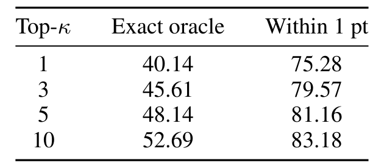
*论文原图编号：Table S4。未细化候选池内不同排序深度的最优轨迹检索。*

## 深度分析

### 计算与交互的权衡

路径查询让不同候选从同一未来场读取不同位置的证据，避免对每个候选分别展开世界模型；它能区分候选经过了哪里，却不会因自车选择不同轨迹而预测交通参与者的不同反应。因此，互动合流、让行等需要反事实反应的场景，可能出现同一预测场下的排序偏差。相对逐候选未来展开，节省计算是结构上的合理预期；论文未给出覆盖所有模块的同预算端到端延迟对比，不能据此量化整体加速倍数。

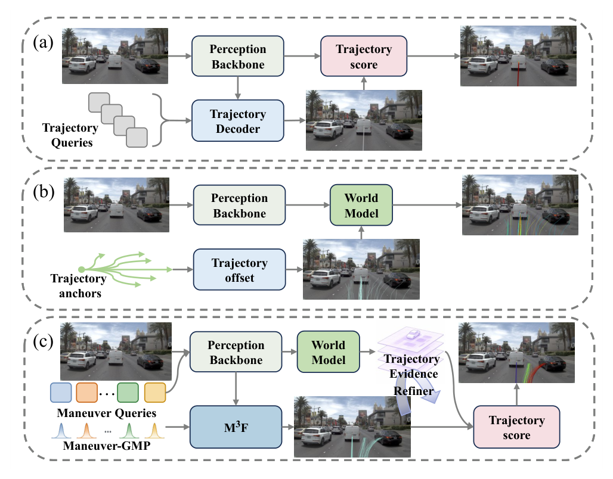
*论文原图编号：Figure 1。不同候选生成与未来评估范式的对照。*

### 复现和扩展

先重建 navtrain 的八分量规则、轨迹归一化和分量统计，再检查训练随机路由与推理预算分配；对齐 0.5 秒路径点与 1 秒未来特征的实际采样规则，并复现越界及有效区域掩码。分别记录生成候选的池内最优、预排序误差、细化前后因子变化和完整系统延迟，避免将候选覆盖不足归因于评分器，或将生成吞吐当作端到端速度。

可以固定候选与评分网络，对比共享未来、按候选预测未来和无未来特征，并按合流、遮挡、稀有动作分类统计碰撞、进度与开销；这能检验共享预测何时足够，以及反事实交互是否值得额外计算。

## 局限

- NAVSIM 的交通不响应预测动作；WorldEngine 虽包括 IDM 闭环，其场景由 navtest 日志重建，不是独立真实道路或实车验证。
- 共享未来场不随候选动作变化；轨迹条件读取无法恢复模型未预测的其他参与者反应。
- 前三分量可能过滤罕见或组合动作；轨迹距离分量召回不等同语义意图准确率。
- v2 沿用 v1 五因子评分，扩展指标未直接用于训练或排序；细化增加综合分的同时，无碰撞因子出现下降。
- 参数量匹配与消融支持所测设置，但尚不足以解释跨数据、跨模型或真实驾驶环境中的全部收益。

## 我的笔记

值得把问题拆成三项：生成器能否提供好轨迹、评分器能否在现有池中找到它、细化能否在安全约束下改善它。实验应同时报告池内最优、排序误差、修正前后分项指标，以及随候选数量变化的完整延迟；再用可反应的交通模型检查共享未来对排序的偏差。

## 引用

- Wei et al. (2026). [ManeuverFlow: Maneuver Hypothesis Generation with Future Evidence for Trajectory Evaluation and Refinement in End-to-End Autonomous Driving](https://arxiv.org/abs/2610.13409).
- Dauner et al. (2024). NAVSIM: Data-Driven Non-Reactive Autonomous Vehicle Simulation and Benchmarking.
- Geng et al. (2026). Improved Mean Flows.
- Li et al. (2025). End-to-End Driving with Online Trajectory Evaluation via BEV World Model.
- Wang et al. (2026). MeanFuser.
