---
tags:
  - papers/自动驾驶
aliases:
  - PlanWAM
date: 2026-10-08
arxiv_id: "2610.11382"
---

# PlanWAM: Planning-Shaped Future Representations for End-to-End Autonomous Driving

## 核心信息

- 标题: PlanWAM: Planning-Shaped Future Representations for End-to-End Autonomous Driving
- 标题翻译: PlanWAM：面向端到端自动驾驶的规划塑形未来表征
- 作者: Jinchang Xu, Hongda Yu, Fengwei Dong, Wenhui Huang, Xi Wei, Yongzhi Liu, Sunan Zhang, Jirao Wang, Chen Lv, Bingbing Li, Guodong Yin, Weichao Zhuang
- 机构: Southeast University；NIO；Nanyang Technological University；Tongji University
- 发表时间: 2026-10-08
- 发表渠道: arXiv 预印本
- arXiv: 2610.11382
- 论文链接: https://arxiv.org/abs/2610.11382
- 代码 / 项目: https://jinchan9.github.io/PlanWAM_project_page
- 论文类型: 自动驾驶世界模型与轨迹规划方法

## 原文摘要翻译

端到端自动驾驶中的世界模型预测场景未来演化，为轨迹规划提供前瞻信息。现有方法主要研究如何预测和利用未来，**却较少追问哪种未来表征最有利于规划**。为此，作者提出规划塑形世界动作模型 `PlanWAM`：让规划任务塑造未来状态表征，使其保留对规划最有用的信息，再由潜在世界模型根据历史观测预测该表征并用于规划。具体而言，时间寄存器金字塔按照时间远近压缩多帧历史信息，形成用于未来推理和规划的紧凑历史表示。训练时引入可以看到真实未来帧的特权后验分支，用轨迹规划目标塑造其未来潜变量；然后通过从事后信息到前瞻预测的蒸馏，训练仅依赖历史的先验分支预测该潜变量。预测结果作为规划上下文，引导轨迹生成和选择。该模型在 `NAVSIM-v1/v2 navtest` 上的规划得分和扩展规划得分分别达到 `93.8` 和 `90.9`，在零样本闭环 `HUGSIM` 上的驾驶得分达到 `38.7`。实验还表明，规划塑形的未来表征可为世界动作模型提供有效且可部署的前瞻信息。

## 创新点

1. **规划塑形的未来教师**：训练时用真实未来视觉寄存器构造后验查询，直接让轨迹生成与评分损失塑造未来潜变量，而非主要优化图像或通用特征重建。
2. **从后验到先验的蒸馏**：将训练阶段的特权未来潜变量逐槽对齐到只看历史的先验，部署时移除未来输入。
3. **历史与未来共同服务选择**：将不同时间尺度的历史压缩为紧凑表示，与预测未来潜变量拼接，同时条件化候选轨迹生成及评分。

## 一句话总结

论文先用可见真实未来的教师学习对规划有用的潜变量，再训练仅看历史的学生预测它，最终让预测特征同时参与轨迹生成和排序。

## 研究问题

未来世界表征可由像素、通用图像特征或鸟瞰特征的预测任务训练，但重建得好并不必然意味着保留了决定驾驶轨迹选择的因素。作者提出在特权未来分支上直接使用规划目标，再把该目标迁移到可部署的历史条件模型；核心对照是规划塑形与论文实现的通用未来特征监督。

## 数据与任务定义

训练使用 `NAVSIM navtrain`，评估使用 `navtest` 的 `12,146` 个场景；候选轨迹由非交互式日志模拟器评分。补充评估将同一检查点零样本部署到 `HUGSIM` 的 `436` 个公开场景，评估动作影响后续观测的闭环表现。

输入包括前、左、右、后四个相机的四帧历史，以及自车状态和导航信息。训练用后验还读取未来 `1、2、3、4 s` 的相机帧；推理只能使用历史。输出为 `64` 条候选，每条含 `8` 个二维位置和航向点，覆盖 `4 s`，再由评分器选出一条。

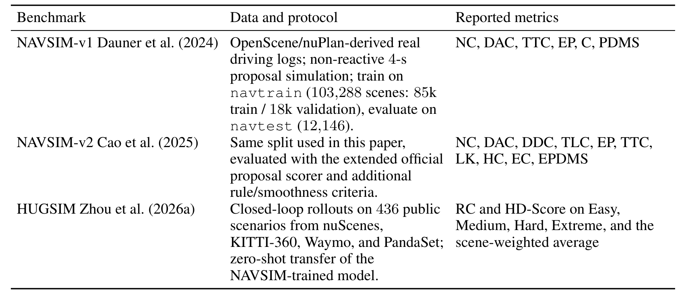
*论文原图编号：Table 12。各数据集的评估协议和指标。*

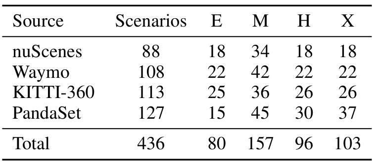
*论文原图编号：Table 13。HUGSIM 的场景来源和难度分布。*

## 方法主线

### 机制流程

1. **压缩历史**：输入四帧四相机图像，经视觉编码器提取场景寄存器；时间金字塔对较近历史分配更多查询，输出 `128` 个历史令牌。
2. **训练特权后验**：将未来帧的 `256` 个场景寄存器作为查询，以历史为键和值聚合，得到未来潜变量；与历史拼接后输入规划器和评分器，由两者损失共同塑造。
3. **蒸馏历史先验**：用同样的未来时间、相机、槽位顺序构造可学习查询，以历史为条件预测 `256` 个未来令牌，并对齐冻结后验的对应槽位。
4. **生成并评分**：推理时移除后验，拼接历史与预测未来形成 `384` 个令牌的记忆；规划器解码 `64` 条候选，评分器查询同一记忆并输出各候选的六个子分数。

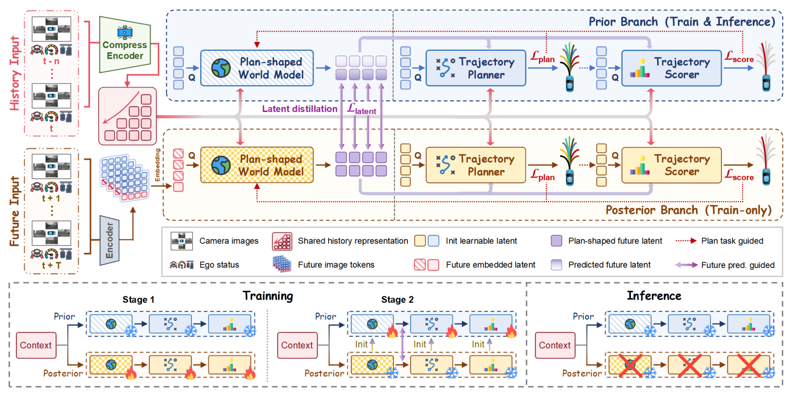
*论文原图编号：Fig. 2。训练后验、历史先验和两阶段优化的关系。*

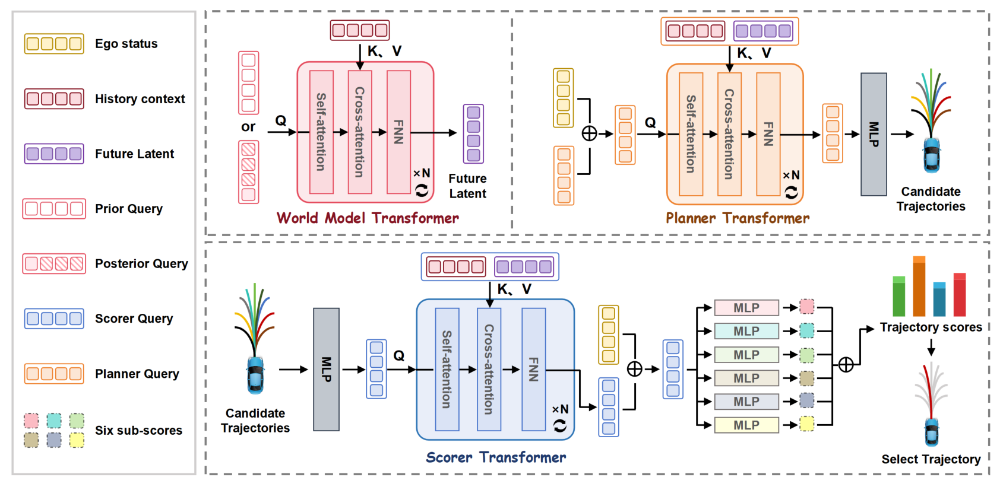
*论文原图编号：Fig. 6。世界模型、规划器及评分器的查询与上下文连接。*

### 张量与训练目标

视觉骨干是冻结基础权重、采用秩为 `32` 的 `LoRA` 适配的 `DINOv2 ViT-S`。每相机帧提取 `16` 个寄存器；由旧到新的历史层每相机使用 `[4, 4, 8, 16]` 个查询。世界模型为四层、隐藏维度 `256` 的变换器；规划器与评分器也各使用四层变换器。

设后验目标为 $z_t^+$，历史先验为 $\hat z_t^+$，未来槽位数为 $N_z$、通道维度为 $d$，蒸馏目标为：

$$
\mathcal L_{\mathrm{latent}}=\frac{1}{N_zd}\left\|\hat z_t^+-\operatorname{sg}(z_t^+)\right\|_F^2.
$$

第一阶段用真实未来训练后验、规划器与评分器；第二阶段冻结教师，以兼容权重初始化先验，优化规划损失、评分损失和权重为 `0.05` 的潜变量对齐损失。规划损失对最接近示范轨迹的候选做回归；评分器使用模拟器生成的碰撞、可行驶区域、碰撞时间、进度、方向及舒适度标签。评分输入的轨迹几何被截断梯度。两个阶段各训练 `50` 轮，分别使用峰值学习率 `1e-4` 和 `1e-5`，`16` 张 `A800`、每卡批量 `8`。

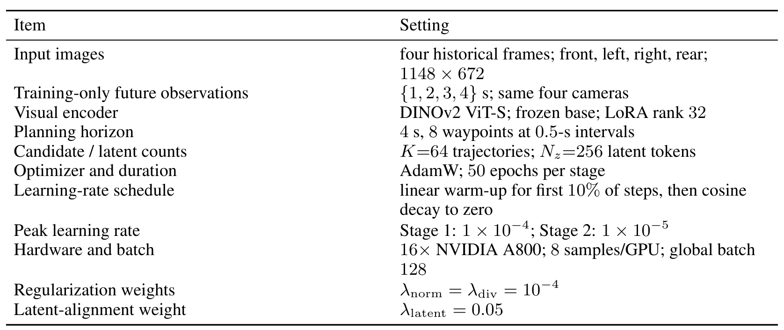
*论文原图编号：Table 11。模型的训练与实现配置。*

## 关键结果

### 主结果及闭环对比

| 评估                            |   对照 | PlanWAM | 含义            |
| ----------------------------- | ---: | ------: | ------------- |
| NAVSIM-v1：DrivoR，PDMS         | 93.1 |    93.8 | 高 `0.7` 分     |
| NAVSIM-v1：DriveFuture，PDMS    | 90.7 |    93.8 | 对照论文列出的世界模型方法 |
| NAVSIM-v2：DriveFuture，EPDMS   | 89.9 |    90.9 | 高 `1.0` 分     |
| HUGSIM：Latent-WAM，平均路线完成度     | 45.9 |    53.7 | 零样本闭环         |
| HUGSIM：Latent-WAM，平均 HD-Score | 28.9 |    38.7 | 零样本闭环         |

`HUGSIM` 平均值按各难度场景数加权，不是四个难度的等权平均。该模型在中等难度的 `HD-Score` 为 `32.9`，低于 `GTRS-Dense` 的 `39.0`；在 `NAVSIM-v2`，扩展舒适度为 `70.5`，也并非最优。表中的总分优势不能推成每项指标、每个场景都领先。

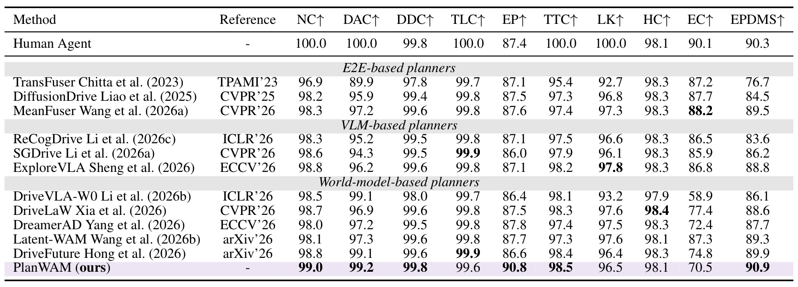
*论文原图编号：Table 1。NAVSIM-v2 测试集的综合分和子指标对比。*

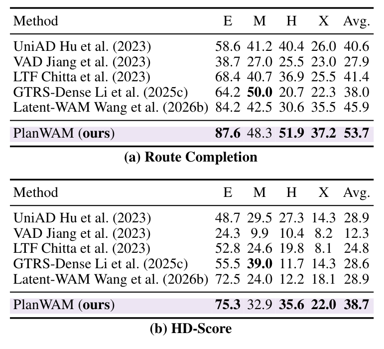
*论文原图编号：Table 3。HUGSIM 分难度的路线完成度和驾驶得分。*

### 消融：表征与评分各贡献什么

| 设置 | PDMS ↑ | 解释 |
|---|---:|---|
| 无未来潜变量 | 93.4 | 对照 |
| 通用未来寄存器重建 | 93.5 | 给定实现下仅小幅提升 |
| 规划损失塑形未来潜变量 | 93.8 | 生成和评分共同使用 |
| 潜变量只用于生成 | 93.5 | 对最终分数帮助有限 |
| 潜变量只用于选择 | 93.7 | 在此设置下选择端贡献更明显 |
| 特权后验，看到真实未来 | 95.0 | 训练用参照，不能作为部署结果 |

初始化和蒸馏使先验潜变量的平均余弦相似度从 `0.22` 提升至 `0.93`，规划分数从 `93.4` 增至 `93.8`。但更高的表征相似度不保证更好规划：蒸馏权重从 `0.05` 增至 `0.10` 时，相似度由 `0.93` 升至 `0.95`，得分却从 `93.8` 降至 `93.7`。只训练先验世界模型并冻结下游模块时，相似度 `0.96` 而得分仅 `93.0`；联合训练评分器、规划器及其他允许更新模块后才达到 `93.8`。

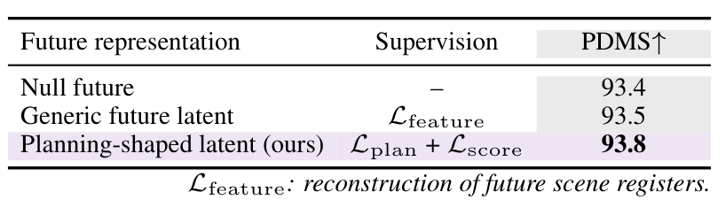
*论文原图编号：Table 5。未来表征与监督方式的消融对比。*

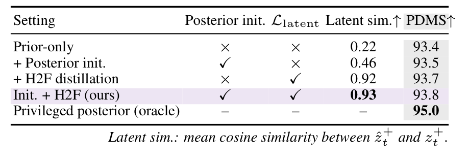
*论文原图编号：Table 8。后验初始化、蒸馏以及不可部署的特权后验对照。*

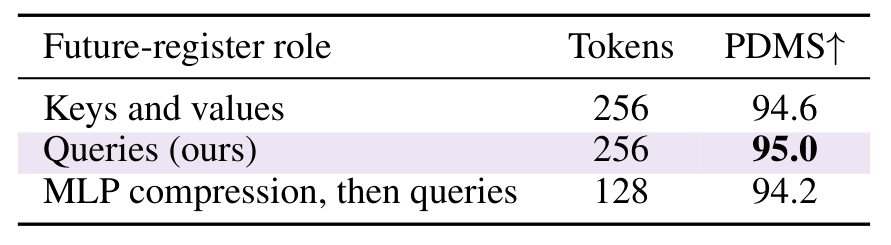
*论文原图编号：Table 14。特权后验中，未来寄存器作为查询或键值的比较。*

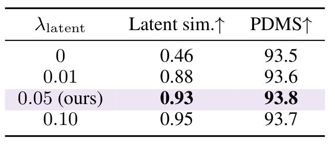
*论文原图编号：Table 16。蒸馏权重、潜变量相似度和规划得分并不单调一致。*

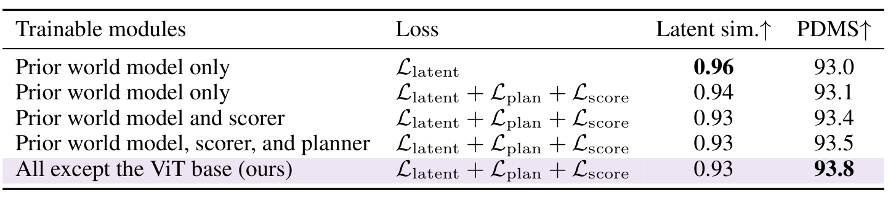
*论文原图编号：Table 17。固定下游模块与联合训练的比较。*

### 定性结果

论文展示了转弯、交叉口、城市道路和密集交通中的候选及选中轨迹。这些图可辅助理解输出形态，不能单独证明普遍安全。

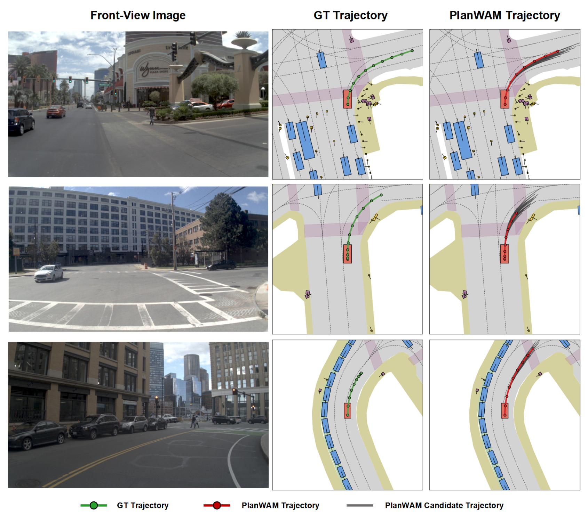
*论文原图编号：Fig. 7。三组候选、选中轨迹与记录轨迹。*

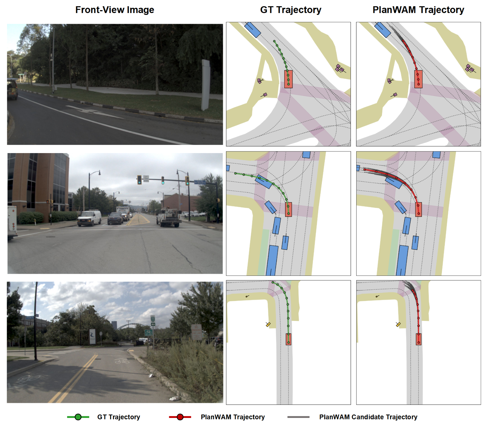
*论文原图编号：Fig. 8。弯道与交叉口场景。*

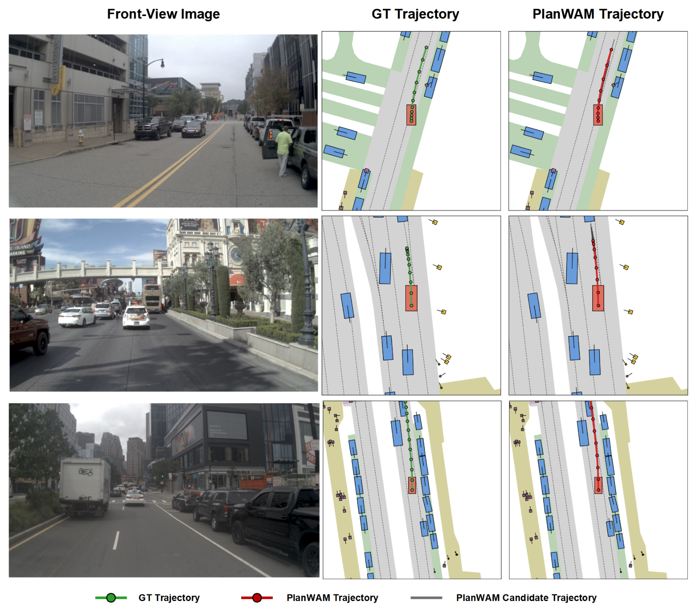
*论文原图编号：Fig. 9。城市道路及周围交通场景。*

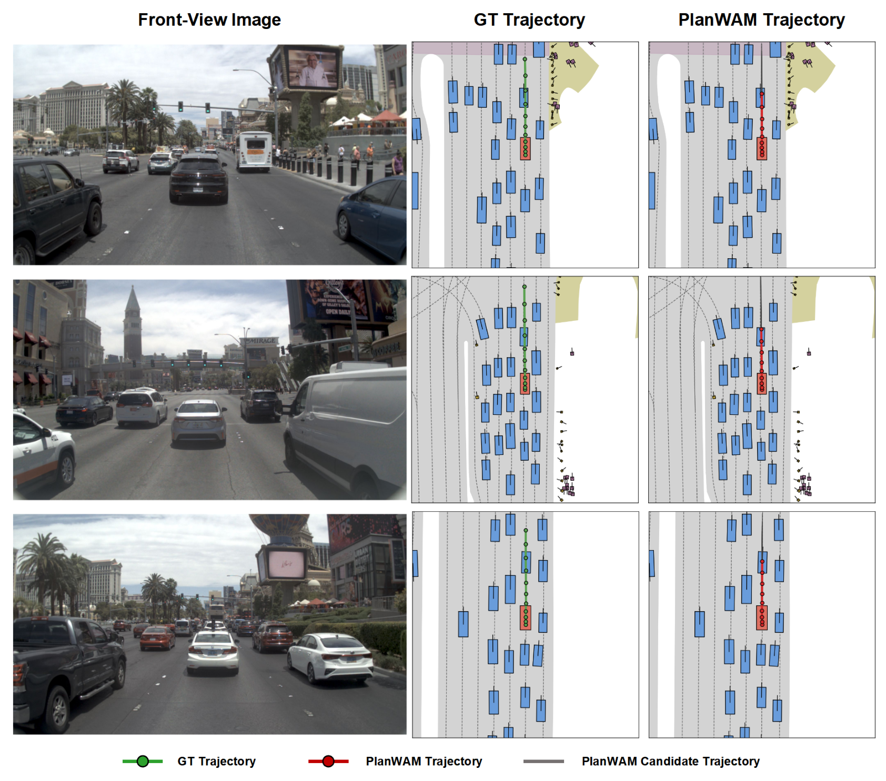
*论文原图编号：Fig. 10。密集多车道交通中的候选与选择。*

## 深度分析

### 机制与证据的对应

后验直接使用真实未来视觉寄存器作为查询，再由候选生成及评分损失更新表示，因此有限容量可能优先保留对这两项任务有用的信息。先验从历史预测同形状令牌，使部署时不读取未来。论文的 `93.5→93.8` 对照支持这一具体教师目标在当前设置下优于其通用寄存器重建目标；它并未覆盖所有通用世界模型目标，也不能据此认定像素预测普遍无效。

只在评分端使用未来潜变量已达到 `93.7`，说明信息可能尤其有助于区分候选。该结果仍与候选生成分布、模拟器标签及模型规模相关，尚不能单独证明先验恢复了真实未来的完整多模态分布。

### 复现与扩展

复现应固定未来令牌的时间、相机和槽位对应，确保教师冻结且未来帧不会进入学生；同时复现模拟器评分标签、候选回归、梯度截断以及每阶段训练时长。应分别衡量候选覆盖、选择误差、轨迹舒适度和闭环失败，避免仅用潜变量余弦相似度代替任务表现。

## 局限

- 特权后验的 `95.0 PDMS` 依赖真实未来；可部署先验是 `93.8`，两者差距仍在。
- `NAVSIM` 的其他交通参与者遵循日志，`HUGSIM` 虽为闭环但只有 `436` 个模拟场景；论文未验证真实车辆长期安全。
- 单一确定性槽位对齐可能平均不同合理未来；论文未充分证明罕见交互和多模态未来的覆盖。
- 主指标提高伴随部分子指标不足，例如扩展舒适度；实际应用需单独评估。

## 我的笔记

可对固定候选集分别比较仅历史评分、预测潜变量评分和真实未来后验评分，分解候选覆盖误差与排序误差。进一步应在等骨干、等训练算力下对照通用未来教师、规划目标教师和只蒸馏评分结果，并报告不同交通参与者反应下的失效案例。

## 引用

- Dauner et al. (2024). NAVSIM: Data-Driven Non-Reactive Autonomous Vehicle Simulation and Benchmarking.
- Cao et al. (2025). Pseudo-Simulation for Autonomous Driving.
- Kirby et al. (2026). Driving on Registers.
- Hong et al. (2026). DriveFuture.
- Wang et al. (2026). Latent-WAM.
