---
tags:
  - papers/autonomous-driving
  - world-model
  - trajectory-evaluation
aliases:
  - RFWorld
date: 2026-11-03
arxiv_id: 2611.05072
---

# Trajectory Evaluation via Rollout-Free World Model for End-to-end Autonomous Driving

## 核心信息

- 标题: Trajectory Evaluation via Rollout-Free World Model for End-to-end Autonomous Driving
- 标题翻译: 基于免展开世界模型的端到端自动驾驶轨迹评估
- 作者: Junzhe Wang、Jinqing Zhang、Qingjie Liu
- 机构: 北京航空航天大学虚拟现实技术与系统全国重点实验室；小米汽车
- 发表时间: 2026-11-03
- 发表渠道: arXiv 预印本；论文首页标注 NeurIPS 2026
- arXiv: 2611.05072
- 论文链接: [arXiv 摘要与原文](https://arxiv.org/abs/2611.05072)
- 论文类型: 自动驾驶规划与世界模型方法

## 原文摘要翻译

尽管现有候选轨迹评估器已显著提高端到端规划精度，其内在机制仍有改进空间。基于模型的评估器通常通过显式预测规划时域内以候选轨迹为条件的未来状态，使评分具有未来意识；论文将这一过程称为展开。然而，展开会带来高推理成本并累积预测误差。作者认为，**规划无须为每条候选轨迹重建完整未来场景，只需获得足以可靠比较候选的未来相关信息**。因此，论文提出用于端到端轨迹评估的免展开世界模型 `RFWorld`。它构建共享场景记忆，并通过训练期间带语义监督的轻量时序读取，将记忆塑造成可读取未来信息的表示，保持较低的训练开销。推理时，候选轨迹通过稀疏空间读取直接查询共享记忆并评分，使计算量大致减少与规划时域长度和候选轨迹数量乘积相关的倍数，同时避免递归展开误差。在 `NAVSIM` 和 `Bench2Drive` 上的实验表明，`RFWorld` 学到了更契合规划的世界表示，并取得了当时领先的结果。

## 创新点

1. **重新设计评分接口。** 把为每条候选分别生成未来场景，改为一次构建共享场景记忆、按候选路点读取；各候选统一放在当前自车坐标系的鸟瞰图平面，便于共享空间参照。
2. **训练时注入未来信息。** 用时刻嵌入调制共享记忆的通道，再以共享解码器预测当前及未来语义图；训练期监督塑造表示，推理时无需生成这些语义图。
3. **以稀疏读取完成轨迹比较。** 可变形注意力围绕路点读取少量位置，结合自车状态预测模仿奖励和仿真奖励，并选择最高分候选。实验证据包括未来监督消融、候选数量与延迟比较、闭环评测。

## 一句话总结

`RFWorld` 将未来语义信息压入一份共享鸟瞰图记忆，再以稀疏路点查询对候选轨迹评分，试图保留规划所需的预见性，同时免去逐候选的未来状态展开。

## 研究问题

多模态候选生成器可以提出多条合理轨迹，难点转向如何可靠比较安全性和行驶进度。显式世界模型可针对每个候选预测未来并评分，但当候选数量和预测时域增长时，重复的未来状态生成很昂贵；递归预测还可能积累误差。

本文的问题是：**是否可以只生成一次共享场景表示，把未来信息在训练时写入其中，并在推理时直接读取与各候选相关的特征？** 这里的“免展开”限定于评分阶段不显式生成逐候选未来状态，不表示系统不依赖未来监督，也不表示任意交通反事实都已被准确建模。

## 数据与任务定义

### 输入、输出与评分

输入包括历史帧信息、当前激光雷达特征、多视角图像和自车状态；在闭环设置中还使用导航指令。规划器从预定义锚点出发生成候选，并对每条候选的多个未来路点读取共享记忆。输出是最高评分轨迹 $\tau^*=\arg\max_i s_i$。奖励头分别估计与专家行为的相似度，以及由仿真器提供的安全与规划指标。

### 数据集与协议

| 基准 | 数据和设置 | 主要度量 |
| --- | --- | --- |
| `NAVSIM-v1` | 官方划分：85,109 个训练样本、18,179 个验证样本、12,146 个测试场景；每个测试场景只选一条最终轨迹 | 无责任碰撞 `NC`、可行驶区域遵守 `DAC`、自车进度 `EP`、碰撞时间 `TTC`、舒适度及综合分 `PDMS` |
| `Bench2Drive` | `CARLA 0.9.15` 中官方 220 条闭环测试路线，执行与环境反馈持续交互 | 成功率和驾驶分数 |

对归一化子指标，论文给出：

$$
\mathrm{PDMS}=\mathrm{NC}\cdot\mathrm{DAC}\cdot(5\mathrm{TTC}+5\mathrm{EP}+2\mathrm{Comf.})/12.
$$

因此碰撞和可行驶区域指标会以乘法影响综合分。

## 方法主线

### 机制流程

1. **输入与候选生成：** 历史激光雷达对齐到当前自车坐标，和当前多视角图像融合得到鸟瞰图特征；预定义轨迹锚点与场景交互并预测偏移，输出候选轨迹集合。
2. **构建共享记忆：** 将鸟瞰图特征展平并加入空间位置编码，送入基于 `Transformer` 的潜在世界模型，得到所有候选共同使用的空间记忆。
3. **训练期塑形：** 从共享记忆提取全局上下文，结合时刻嵌入生成通道门控；共享语义解码器读取当前和选定未来时刻的门控特征，以语义标签监督，梯度回传到记忆编码器。
4. **推理期评分：** 候选路点与自车状态形成查询，可变形注意力在共享记忆上稀疏采样；沿轨迹聚合路点特征，输入奖励头，输出综合评分并选取最高分轨迹。

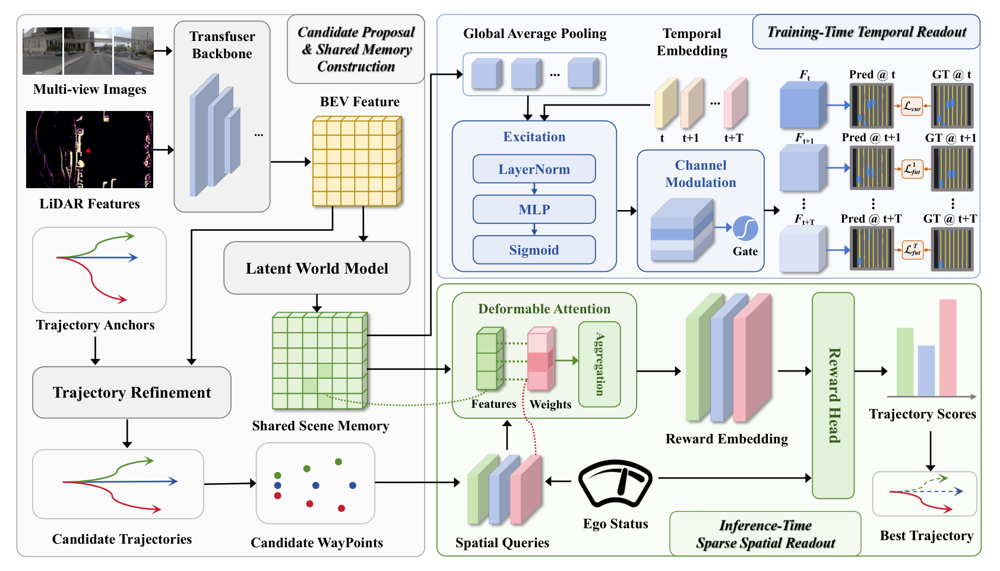
*论文原图编号：Figure 2。共享记忆、训练期时序监督和推理期稀疏评分的整体结构。*

### 时间门控如何塑造记忆

记空间形式的共享记忆为 $\bar M_t$，其全局平均池化为 $c_t$；未来时刻 $k$ 的可学习嵌入为 $e_k$。训练期按通道生成门控并广播到各空间位置：

$$
g_k=2\sigma\!\left(\operatorname{MLP}(\operatorname{LN}(c_t+e_k))\right),\qquad M^{(k)}=\bar M_t\odot g_k.
$$

同一语义解码器处理各时刻的 $M^{(k)}$，用当前及所选未来语义图计算监督损失。门控范围为 $(0,2)$，因此可以增强或抑制通道；时间差异来自时刻嵌入与门控，而非每个时刻独立的解码头。该分支仅在训练时使用，不是推理时的逐候选未来生成器。

### 稀疏空间读取与奖励

对候选 $i$ 的第 $k$ 个路点，模型编码路点并注入自车状态，预测采样偏移和权重，在共享记忆中以双线性插值读取：

$$
z_{i,k}=\sum_{m=1}^{M}\alpha_{i,k}^{m}\,\mathcal V\!\left(\bar M_t,r_{i,k}+\Delta_{i,k}^{m}\right).
$$

其中 $r_{i,k}$ 为路点在鸟瞰图上的参考位置；偏移 $\Delta$ 与权重 $\alpha$ 均由网络学习，$M$ 为采样点数。模型沿时域聚合读取特征，再结合自车状态预测模仿奖励与仿真奖励，聚合为最终分数。关键接口是“候选的路点位置查询同一份记忆”，而非每个候选拥有自己的完整未来记忆。

### 训练目标与实现

总损失由轨迹、语义、模仿奖励和仿真奖励损失加权得到：

$$
\mathcal L=\lambda_{traj}\mathcal L_{traj}+\lambda_{sem}\mathcal L_{sem}+\lambda_{im}\mathcal L_{im}+\lambda_{sim}\mathcal L_{sim}.
$$

轨迹损失只监督最接近真实轨迹的锚点；语义图用焦点损失；模仿奖励由候选与专家轨迹的相对距离构造软目标并采用交叉熵式损失；仿真奖励头使用仿真器目标训练，并对进度加入间隔排序约束。

`NAVSIM` 使用 `ResNet-34` 骨干、1,024 个候选，2 张 `RTX 3090`、批量大小 16，`AdamW` 学习率 $10^{-4}$，训练 50 个周期。闭环实验使用三个前向相机、连续四帧激光雷达、自车状态和导航指令；以预训练权重初始化，批量大小 8、学习率 $5\times10^{-6}$，训练 30,000 次迭代。推理时对 1,024 个候选评分，`PID` 控制器追踪第六个轨迹点，油门上限为 0.55。

## 关键结果

### NAVSIM：综合分领先，但子指标并非全部最优

| 方法 | NC ↑ | DAC ↑ | TTC ↑ | 舒适度 ↑ | EP ↑ | PDMS ↑ |
| --- | ---: | ---: | ---: | ---: | ---: | ---: |
| `WoTE` | 98.5 | 96.8 | 94.9 | 99.9 | 81.9 | 88.3 |
| `ResWorld` | 98.9 | 96.5 | 95.6 | 100.0 | 83.1 | 89.0 |
| `DriveSuprim` | 97.8 | 97.3 | 93.6 | 100.0 | 86.7 | 89.9 |
| `DriveDPO` | 98.5 | 98.1 | 94.8 | 99.9 | 84.3 | 90.0 |
| `RFWorld` | **99.0** | 97.8 | **96.0** | 100.0 | 84.6 | **90.5** |

以上是论文表 1 的同骨干比较。`RFWorld` 相比 `DriveDPO` 高 0.5 个综合分点；但其 `DAC` 低于 `DriveDPO` 的 98.1，`EP` 低于 `DriveSuprim` 的 86.7。各方法监督来源也不完全相同，因此不能将分数差异全部归因于共享记忆结构。该比较支持论文所列设置中的综合性能优势，不能推导每种安全或效率维度都最优。

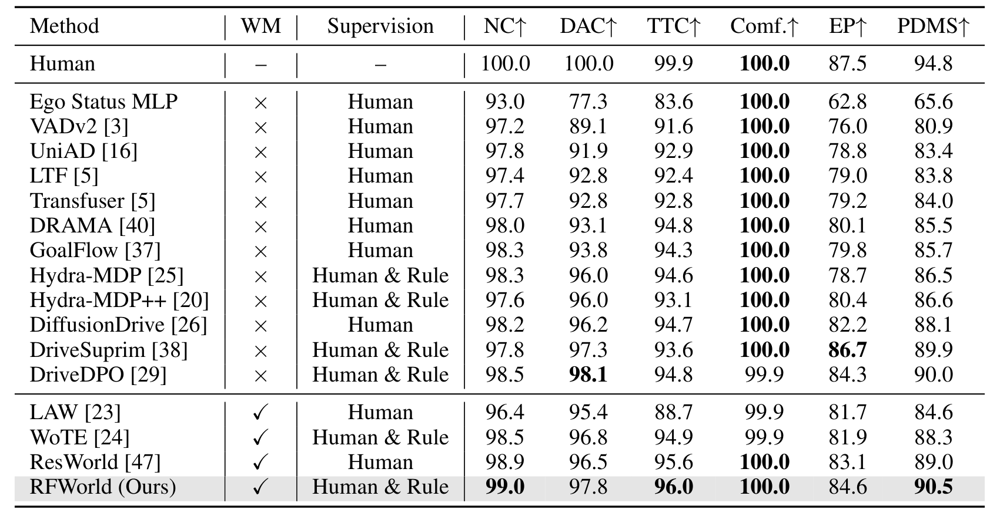
*论文原图编号：Table 1。相同骨干下的 NAVSIM 主结果及全部比较方法。*

### Bench2Drive：220 条路线的闭环比较

| 方法 | 成功率 ↑ | 驾驶分数 ↑ |
| --- | ---: | ---: |
| `AD-MLP` | 0.00% | 18.05 |
| `VAD` | 15.00% | 42.35 |
| `UniAD` | 16.36% | 45.81 |
| `TCP` | 30.00% | 59.90 |
| `RFWorld` | **31.36%** | **62.38** |

相较于表中最强基线 `TCP`，成功率高 1.36 个百分点、驾驶分数高 2.48 分。论文未在此表报告多随机种子方差或显著性，不能据此判断小幅成功率差距的统计稳定性。

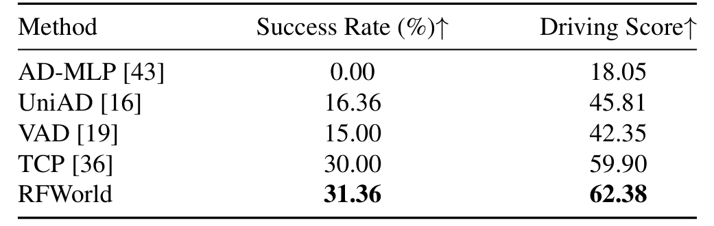
*论文原图编号：Table 2。Bench2Drive 的 220 条路线闭环比较。*

### 消融：未来监督与共享世界模型相互配合

| 世界模型 | 未来语义监督 | PDMS ↑ |
| --- | --- | ---: |
| 无 | 无 | 88.9 |
| 无 | 有 | 89.4 |
| 有 | 无 | 88.4 |
| 有 | 有 | **90.5** |

四组使用固定的骨干、候选锚点、训练计划和评估协议。仅加入世界模型反而从 88.9 降至 88.4；只在骨干鸟瞰图上加未来监督升至 89.4；两者结合达到 90.5。这支持“未来监督有助于塑造可用于规划的共享记忆”，但不能单凭该消融证明全部收益由某一个门控通道或内部表征独立造成。

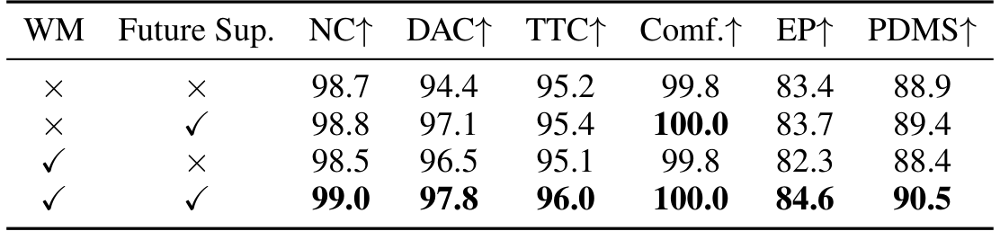
*论文原图编号：Table 3。世界模型与未来监督的双因素消融。*

附录还改变未来监督时刻数量，0、2、4、6、8 个时刻分别得到 `PDMS` 88.4、89.5、90.0、90.3、90.5。中间设置从预测时域的前后半段随机选取时刻；结果说明在这些设置下覆盖更密的未来监督有益，并不能证明任意更长时域都继续受益。

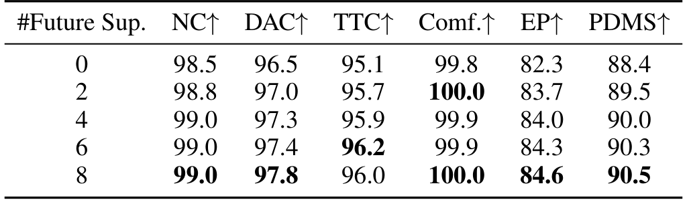
*论文原图编号：Table 5。不同未来监督时刻数量的消融结果。*

### 候选数量与推理开销

| 候选数 | `WoTE` PDMS ↑ | `WoTE` 延迟 ↓ | `RFWorld` PDMS ↑ | `RFWorld` 延迟 ↓ |
| ---: | ---: | ---: | ---: | ---: |
| 256 | 88.3 | 37.0 ms | 89.6 | 35.1 ms |
| 512 | 88.4 | 41.2 ms | 90.2 | 36.2 ms |
| 1,024 | 88.7 | 49.2 ms | 90.5 | 37.5 ms |

两种方法都以 1,024 个锚点训练，测试时随机抽取指定数量；延迟为单张 `RTX 3090` 上的每样本测量。1,024 候选下，`RFWorld` 比 `WoTE` 少 11.7 ms，约降低 23.8%，并非端到端实测加速了“候选数乘以时域”倍。论文另报告同批量 16、1,024 锚点设置下显存占用 8.7 GB 与 33.9 GB；两方法训练硬件不同，跨硬件与实现细节应另行复核。

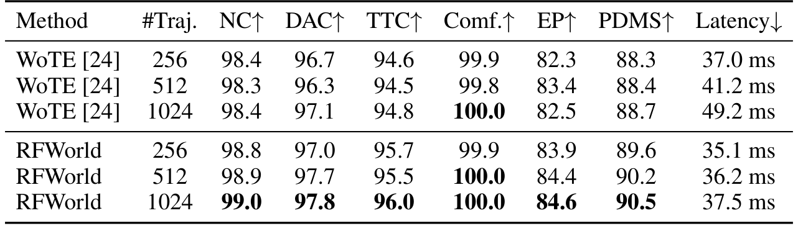
*论文原图编号：Table 4。候选数量、规划指标与单卡推理延迟。*

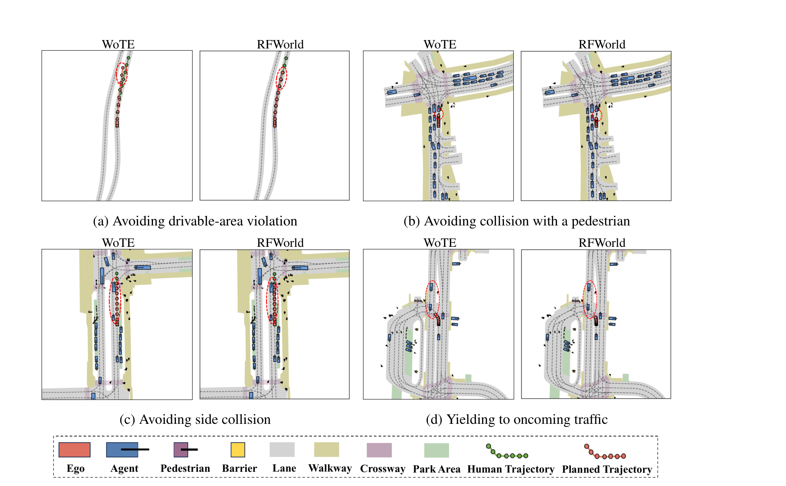
*论文原图编号：Figure 3。可行驶区域、行人、侧向碰撞和转弯让行的定性对照。*

上述可视化展示若干具体场景的行为差异，但不足以估计失败率或单独证明误差累积是唯一原因。

## 深度分析

### 机制与证据链

未来语义监督迫使一份当前记忆能在多个时刻支持语义解码；同一解码头和不同的时序门控让训练信号约束共享通道。完整模型比只加未来监督的版本高 1.1 个 `PDMS` 点，说明在固定实验设置下，引入世界模型与监督的组合具有增益。附录的时序语义图显示部分动态车辆配置随时刻变化，这为记忆包含未来相关信息提供定性证据，而不是对所有物体运动预测准确性的量化证明。

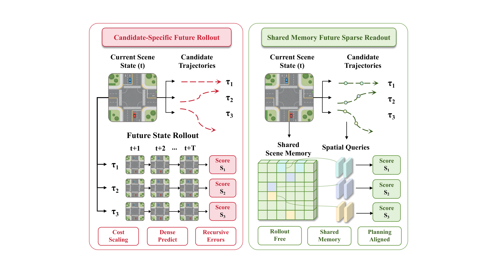
*论文原图编号：Figure 1。逐候选未来展开与共享记忆稀疏查询的计算路径对照。*

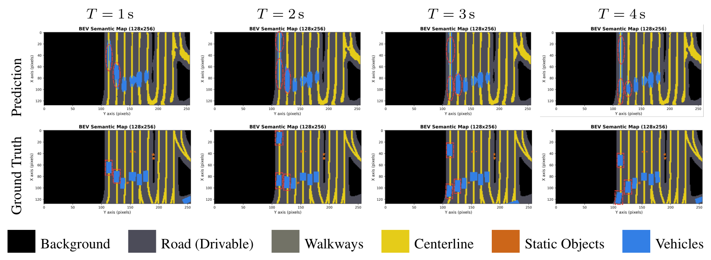
*论文原图编号：Figure 4。训练期不同未来时刻的语义读取预测与真值。*

门控分析显示，多数通道相对当前时刻变化较小，少数通道随未来时刻明显增减；远期门控的跨通道方差增大。作者据此解释为共享通道基底上的时刻特定调制。该统计与设计相符，但相关性本身不能证实具体通道分别编码何种交通因果机制。

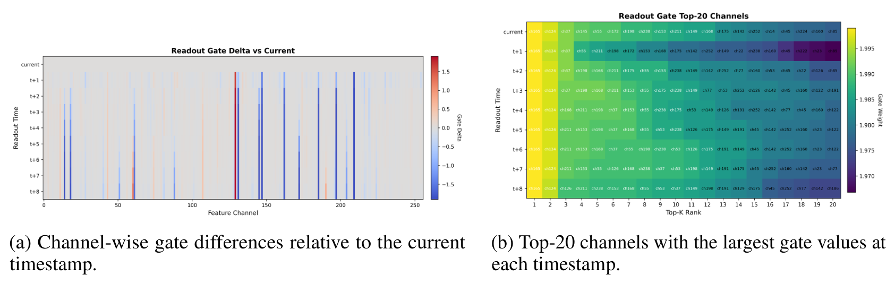
*论文原图编号：Figure 5。时序门控的通道差异和高权重通道。*

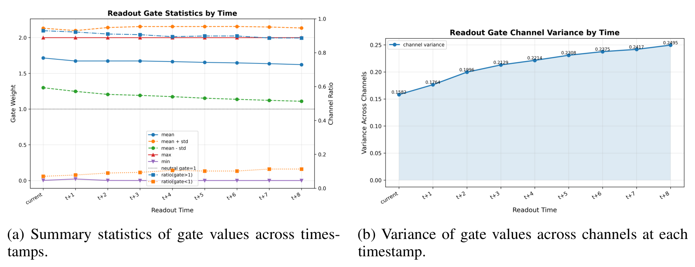
*论文原图编号：Figure 6。不同时刻门控分布及跨通道方差。*

### 复杂度与反事实边界

记候选数量为 $N$、未来步数为 $T$、鸟瞰图令牌数为 $L$、每个路点采样点数为 $M$、通道维数为 $d$。论文估计两种方案的主要计算量分别为：

$$
\text{Rollout}: O(NT\,C_{WM}(L)),\qquad\text{RFWorld}: O(C_{WM}(L))+O(NTMd).
$$

收益来自去除密集未来状态生成中的 $NT$ 重复项。共享记忆构建本身仍有成本，路点采样也仍随 $N$ 和 $T$ 增长，故理论项不能直接当作实际延迟倍数。

共享记忆只由当前观测编码，而具体候选通过位置查询影响评分。对于自车行为会改变其他交通参与者反应的强交互场景，单份记忆能否区分不同动作造成的未来后果，是需要单独验证的假设；论文当前的分数和可视化不能证明其对任意反事实充分。

### 复现时应固定的比较条件

- 固定训练和测试数据、骨干、候选集合、监督来源及预处理，再分离“有无未来监督”和“有无共享世界模型”。
- 对候选数量分别记录评分、显存和端到端延迟，给出硬件、批量、计时范围及预热方式；论文给出了单卡延迟，但未在上述表中完整规定所有计时细节。
- 单独统计遮挡、视野边缘、强交互和候选覆盖不足场景；评估闭环的碰撞、进度与保守停滞，不只看聚合分数。

## 局限

1. **密集记忆扩展成本。** 潜在世界模型使用密集鸟瞰图，空间分辨率提高时计算和存储压力可能上升；作者提出稀疏场景表示作为后续方向。
2. **训练依赖语义目标。** 未来语义标签的质量、可获得性与覆盖范围会影响记忆塑形；无标签迁移和自监督替代方案尚待验证。
3. **感知和观测范围限制。** 轻量骨干的感知错误，以及位于视野边缘或范围外的道路与交通参与者，会传递到评分并可能引发越界或碰撞。
4. **评测外推有限。** `NAVSIM` 的聚合评分和 `CARLA` 闭环路线是有用证据，但真实道路部署的安全性尚无直接证据；闭环表没有列出跨种子不确定性。

## 我的笔记

- **值得保留的思路：** 未来信息可以通过训练期辅助任务约束共享表示，再由候选条件查询读取；若目标仅是排序，未必需要在推理时重建完整未来画面。
- **与轨迹评分研究的连接：** 对同一候选池比较“显式未来预测评分”“共享记忆稀疏评分”和“当前表征直接评分”，同时匹配训练监督与推理预算，才能定位节省的计算与丢失的交互信息。
- **可检验问题：** 在车辆让行或行人博弈中，对同一当前场景构造会诱发不同他车反应的候选，测量候选排序与碰撞风险；再按可观测性和未来监督质量分组。若强交互排序显著退化，共享记忆可能需要候选条件的轻量交互分支。
- **研究判断：** 文章最直接的证据是特定基准下的监督消融和计算对照；“规划充分表示”是有价值的设计假设，尚未由这些实验严格证明。

## 引用

- Wang, Zhang, and Liu. [Trajectory Evaluation via Rollout-Free World Model for End-to-end Autonomous Driving](https://arxiv.org/abs/2611.05072), 2026.
- Li et al. End-to-end Driving with Online Trajectory Evaluation via BEV World Model. 论文中的 `WoTE` 对照。
- Zhang et al. ResWorld: Temporal Residual World Model for End-to-End Autonomous Driving. 论文中的未来状态模型对照。
- Shang et al. DriveDPO: Policy Learning via Safety DPO for End-to-End Autonomous Driving. 论文中的策略优化及轨迹选择对照。
- [[NAVSIM|NAVSIM 数据集与评测]]。
